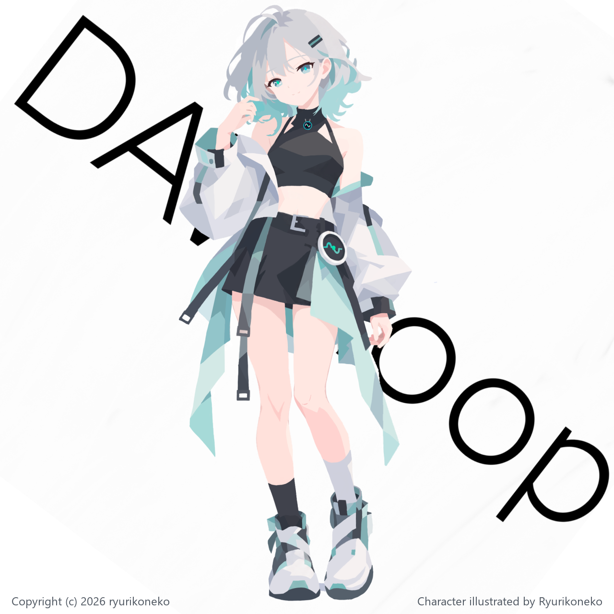
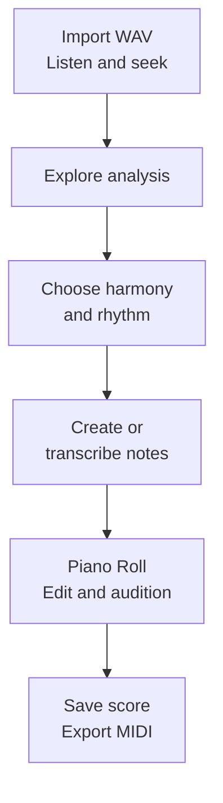
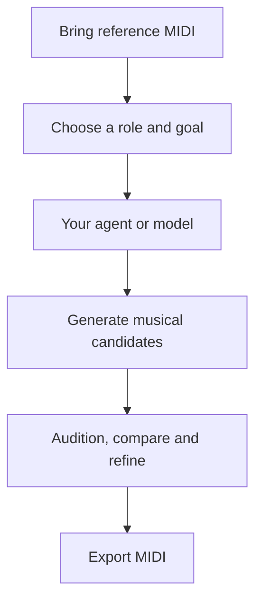
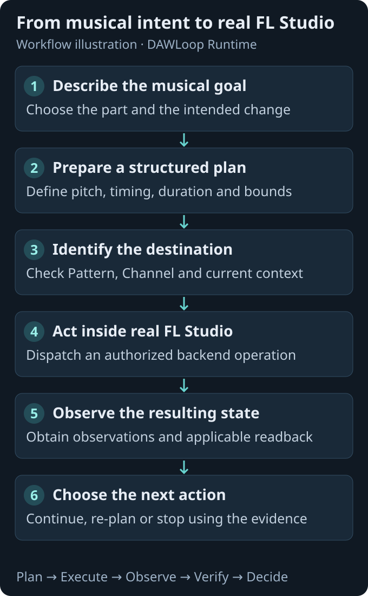
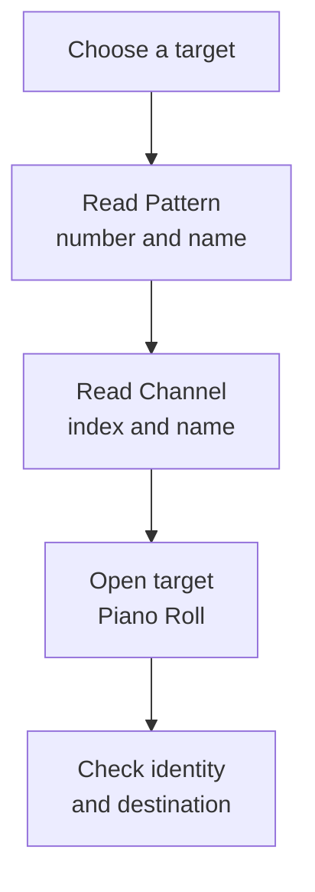
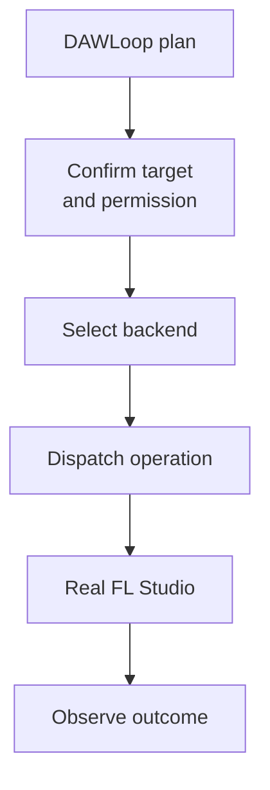
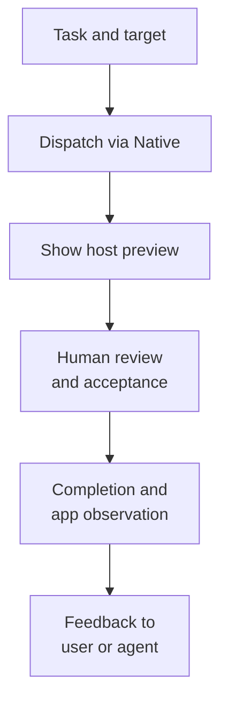
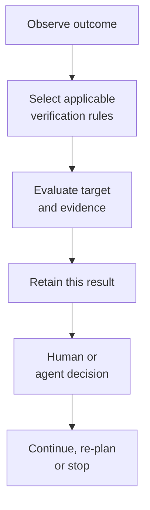
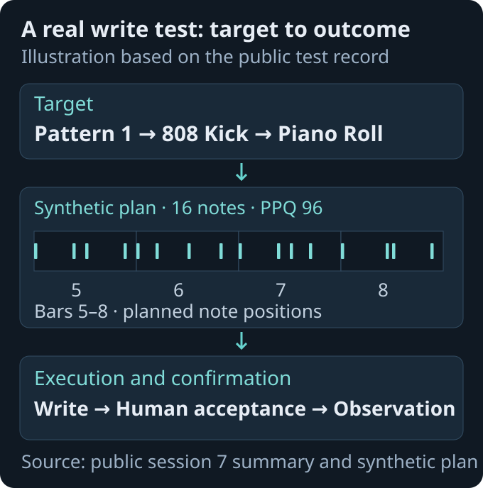

# DAWLoop

**AI Music Creation & DAW Automation**

Bring music creation, AI and real DAW interaction together.

Analyze and edit in Desktop, develop and audition reference-based ideas in Plugin, and build agents that plan, act, observe and verify through Runtime.

[中文](README.md) | [English](README.en.md)

[](https://github.com/ryurikoneko/DAWLoop/actions/workflows/ci.yml)
[](LICENSE)
[](docs/DESKTOP.md)

[Download Desktop Alpha](https://github.com/ryurikoneko/DAWLoop/releases/tag/v0.5.6-alpha.2) · [Download Composer VST3](https://github.com/ryurikoneko/DAWLoop/releases/tag/plugin-v0.2.0-rc.1) · [Try the Runtime](docs/QUICKSTART.md) · [Demos](docs/DEMOS.md) · [Capabilities](docs/CAPABILITIES.md) · [Contribute](CONTRIBUTING.md)



## Choose your workspace

| Product | Purpose and entry |
|---|---|
| **DAWLoop Desktop — Open Source** | Standalone music workspace · [Desktop](docs/DESKTOP.md) |
| **DAWLoop Plugin — Proprietary** | Composer creation inside the host · [Plugin](docs/PLUGINS.md#english) |
| **DAWLoop Runtime — Open Source** | Agent planning, execution and verification · [Quickstart](docs/QUICKSTART.md) |

Plugin is delivered separately from this repository's open-source code. Composer is available as a [Windows VST3 prerelease](https://github.com/ryurikoneko/DAWLoop/releases/tag/plugin-v0.2.0-rc.1).


<br>

---

## DAWLoop Desktop — Open Source

Desktop runs independently of FL Studio. Analyze material, create and edit notes, then export standard MIDI to continue production in your preferred DAW.

### From musical material to an editable melody

Study how a piece changes, or find a melody for an existing harmony. Music Intelligence brings listening, analysis, creation and editing into one workspace.

### Import and analyze music

Import your WAV, listen and seek to an interesting passage, then explore levels, energy, rhythm changes and key candidates. Find where a backing part becomes busier before deciding whether your melody should leave space or become more active.


Interpret the report alongside listening. Save useful analyses and reopen them from the list. Rhythm and key candidates inform your creative choices.

### Create and shape a melody

Set key, harmony, rhythm, length, density and seed to create a rule-assisted melody. With Basic Pitch installed and configured, you can also transcribe notes from instrumental audio.


Select and move notes, change pitch, start, duration and velocity, audition the phrase and undo changes. Name and save a score you want to keep, then export MIDI for further instrument and arrangement work.

### Prepare the components you need

Component Manager shows installation requirements and availability. Review the terms and confirm installation, then prepare basic analysis or Basic Pitch transcription for your task.


### The complete Desktop workflow



Reports inform your direction; you choose composition settings and edits. Optional transcription and rule-based creation lead into the same note-editing workflow.

<br>

---

## DAWLoop Plugin — Composer

**Bring your musical references, your AI collaborator and your real DAW into the same creative process.**

Composer is a VST3 workspace for developing music inside your host. Bring in a chord progression or melody, describe an idea to your own AI, generate alternatives, compare and audition them, then take MIDI back into your DAW for instruments, arrangement and production.

It gives you somewhere to work when you have the beginning of an idea and want to explore what comes next: a lead over your chords, a different harmonization, a bass or arpeggio direction, or a new development that follows the reference rhythm. AI supplies candidates; visible notes and audible comparisons help you choose and shape your own version.


Composer running in real FL Studio: musical goals and harmony above, reference and generated notes below, with auditioning and candidate selection in the same workspace.

### Create inside your preferred DAW

Composer is currently delivered as **Windows x64 VST3** for hosts supporting that format, including **FL Studio, Ableton Live, Cubase, REAPER and Bitwig Studio**. Import reference MIDI, develop and audition candidates in the plugin, then continue arranging through standard MIDI files or host-supported drag and drop. Host support here is based on VST3 format compatibility; the FL-specific clipboard, Piano Roll snapshots and Controller bridge serve FL Studio workflows.

### Start with music you already have

A short musical passage can be enough to start. Import your `.mid` file into the reference area, or use **File → Copy to MIDI clipboard** in FL Studio's Piano Roll and paste it into Composer. The notes appear on the timeline, giving the next creative task concrete musical context.

Describe the reference as chords, melody or another source type, then combine it with musical settings and a prompt. With a four-bar progression, you might look for a more spacious lead; with an existing lead, you might explore harmony and register. Seeing reference and candidate together helps you understand how a new idea relates to the material you want to keep.

With optional FL helper scripts configured, you can also capture the current Piano Roll without saving the project first. A Controller bridge supplies project, Pattern and Channel name context. MIDI files, the official MIDI clipboard and host snapshots offer different ways to bring your material into the workspace. [Input and host setup guide](docs/PLUGINS.md#english)

### Explore several musical roles from one reference

Choose a musical role, then use the main prompt and more specific settings to tell your AI what you want to explore:

| Direction | How it can help your writing |
| --- | --- |
| **Chord** | Explore progressions, inversions and voicings around a reference, comparing harmonic colors |
| **Lead** | Develop melody candidates over existing harmony, with instructions for contour, movement and space |
| **Bass** | Explore bass lines that support the harmony and provide MIDI material for rhythmic and low-end arrangement |
| **Arpeggio** | Develop harmonic ideas into moving broken-chord patterns |
| **Pad** | Prepare sustained-note and harmonic-bed ideas, then choose instruments and layers in the host |

For example, you could ask:

> Develop a warm four-bar lead around these chords. Leave space in the first two bars, then add a little more movement in the second half.

You can also keep the reference rhythm as a constraint while changing the role, emotion or register. Your instructions define the creative direction; the connected agent or model develops candidates from the reference and settings.

### See and shape the musical structure

The harmonic canvas lays out chords in musical time, with note views for both reference and generated material. Follow the progression across bars, see where a phrase enters, and compare its register, timing and pitch relationships with the reference.

Chord editing, register settings, timeline controls and pitch zoom help turn a promising direction into a more specific arrangement. The main prompt sets the overall goal; sections such as Compose, Chord and Emotion provide room for more detailed instructions. Undo and redo support comparing your choices.

### Choose with auditioning, history and A/B tools

Composer includes a sampled piano for auditioning the reference, generated material or both together. Hear how a melody works against the harmony before choosing which instrument should carry it in your DAW.

Candidate history lets you return to previous generations. A/B tools let you retain and audition two choices, comparing their musical direction. Keep a version you like, change the prompt, emotion or harmony, and explore another approach without making the latest result your only point of reference.

This turns a vague preference into something you can evaluate: which phrase is more memorable, which voicing suits the mood, or which register fits the arrangement? Return to the notes and listen before deciding.

### AI Generation & Personalization

**Your agent. Your musical direction.**

Configure your API provider, address and model in settings, or connect your own agent to the plugin. Composer organizes reference notes, musical goals, parameters and candidates in one workspace, giving your AI collaborator concrete inputs and editable MIDI results to hand back to you.

Your approach can grow with your own setup: choose a model suited to your style, develop better prompts, build a reference collection, or connect models you have trained, fine-tuned or configured elsewhere. Composer does not require you to train a model; a familiar agent, useful references and a clear musical goal can be your starting point.

You decide how the AI contributes: offer several harmonic directions, develop a lead over a backing part, or prepare bass and arpeggio candidates. Audition and edit those ideas into your own arrangement. Composer makes the ideas tangible as notes you can compare, revise and continue producing.

API keys are stored in Windows Credential Manager. Explicit test or generation requests send prompts, reference notes and relevant parameters to your provider and may incur provider charges. [Configuration and usage](docs/PLUGINS.md#english)

### Take the chosen idea back into your DAW

When a candidate is worth developing, export standard MIDI or use **Drag MIDI** in a host that accepts MIDI drag and drop to place it on the intended track or note editor. In FL Studio, accept the import confirmation when shown, then continue with your own instruments, sounds, effects and arrangement.

A creative task can therefore lead directly into the next one: explore reference-based ideas in Composer, hand the chosen notes to the host, then develop sound, rhythm and structure in the real project. Use it for a single melody or harmony decision, or make it part of your ongoing agent-assisted workflow.



### Download and start creating

[Download Composer 0.2.0-rc.1 · Windows x64 VST3](https://github.com/ryurikoneko/DAWLoop/releases/download/plugin-v0.2.0-rc.1/DAWLoop-Plugin-V2-0.2.0-rc.1-Windows-x64-VST3-r2.zip) · [Release notes and checksums](https://github.com/ryurikoneko/DAWLoop/releases/tag/plugin-v0.2.0-rc.1)

1. Save your project and close the host. Install the complete VST3 bundle in the standard VST3 directory, then rescan.
2. Open Composer's Getting Started tutorial, import or paste reference MIDI, and configure your API or connect your agent.
3. Choose a musical direction, generate and audition alternatives, then export or drag your chosen MIDI back into your DAW.

The complete bundle includes a sampled piano, worker, fonts and guides; no separate Python installation is required. Microsoft Visual C++ V14 x64 Runtime is required. This is a Windows x64 prerelease; the [Plugin guide](docs/PLUGINS.md#english) covers installation and optional host bridges.

Composer's proprietary implementation is available free for personal and commercial music creation under separate [binary-use terms](https://github.com/ryurikoneko/DAWLoop/releases/download/plugin-v0.2.0-rc.1/DAWLoop-Composer-Binary-Use-Terms-0.2.0-rc.1.txt). Desktop and Runtime retain their existing open-source licenses.

<br>

---

## DAWLoop Runtime — Open Source

Runtime provides Musical Grid, Note Plan, Production Pipeline, agent interfaces, execution adapters and verification tools. It turns musical intent into host tasks with explicit targets and observable outcomes.

### Bring AI actions into real FL Studio

When you ask an agent to prepare a phrase for an instrument, the task can continue into the running DAW. DAWLoop structures the plan, establishes the destination, connects the execution backend to FL Studio and brings results back for the next decision.



1. Describe the goal: choose the instrument and passage you want to change.
2. Prepare the plan: specify notes, timing, durations and permitted bounds.
3. Identify the target: check Pattern, Channel and project context.
4. Execute: dispatch an authorized host action through the selected backend.
5. Observe: obtain actual state and applicable readback.
6. Decide: continue, re-plan or stop using the report.

### Where should the notes go?

The Pattern identifies the musical segment; the Channel identifies its instrument. Controller reads actual identity, while Runtime navigates existing objects and uses UI observation to establish the Piano Roll destination.



### What carries the operation into FL Studio?

Community FL Studio MCP exposes transport, Channel, Piano Roll, Mixer and loaded-plugin parameter tools. DAWLoop adds musical plans, target management and evaluation. Native Gopher provides a separate execution path; Controller identity and navigation support target preparation.



Controller supplies identity and navigation; host actions use the selected Community or Native backend. The [full backend architecture](docs/FL_STUDIO_MCP.md#execution) keeps the paths and their boundaries distinct.

### How do execution and feedback connect?

This Native sequence starts with a task and destination, then dispatches the operation. The user reviews the host preview before completion information and application observation return to the workflow.



The [full message sequence](docs/FL_STUDIO_MCP.md#native-sequence) shows the interaction between participants.

### How does the agent decide what comes next?

An acknowledgement describes execution; actual readback supports checking the musical goal. With complete note events, Exact-Set compares start, duration, pitch, velocity and multiplicity to return PASS / STOP. Other observations are reported under the matching operation rules.



### A real FL Studio note-write test

DAWLoop has completed a controlled note-operation test in real FL Studio, covering target confirmation, execution dispatch, human acceptance, and observation of the outcome.



The illustration follows the public test record and synthetic plan. See the [operation story](docs/DEMOS.md), [public record](evidence/public/fast_session_7.json) and [execution paths](docs/FL_STUDIO_MCP.md) for their sources.

## How the products work together

Desktop supports studying material and editing MIDI outside the host. Composer brings reference-based generation and auditioning into the host. Runtime lets developers extend plans, backends and verification rules. Use one route independently or connect them through MIDI files, clipboard transfer and explicit host actions.

Brain means Runtime planning and rules, Hands means DAW execution backends, and Ears means Production Pipeline analysis and measurement. These responsibilities do not imply seamless automatic synchronization between products.

## Why bring these capabilities together?

- From plans to actions: structure musical intent and reach the real DAW through a backend.
- From actions to evaluation: use targets, execution information and observations to choose the next step.
- From analysis to editing: create in Desktop and extend agent workflows through Runtime.

[Architecture](docs/ARCHITECTURE.md) · [Production Pipeline](docs/PRODUCTION_PIPELINE.md) · [Capabilities and source](docs/CAPABILITIES.md)

## Get started

### Music creators: download Desktop

[Windows x64 Portable ZIP](https://github.com/ryurikoneko/DAWLoop/releases/download/v0.5.6-alpha.2/DAWLoop%2B0.5.6-alpha.2-Windows-x64-Portable.zip) · [Release notes and checksums](https://github.com/ryurikoneko/DAWLoop/releases/tag/v0.5.6-alpha.2)

The application is unsigned. Verify the official source and `SHA256SUMS.txt` before running it, keep system security protections enabled, and back up user data before upgrading.

1. Extract the complete program directory and run `DAWLoop.exe`.
2. In Music Intelligence → Component Manager, read the terms and confirm installation of basic components; add Basic Pitch when you want transcription.
3. Import a WAV to listen and analyze, or create a melody, edit it in the Piano Roll, save and export MIDI.

The [Desktop guide](docs/DESKTOP.md) explains the UI steps. System Python, Node and Codex are unnecessary.

### Developers: start with a Runtime example

Python 3.11+. This synthetic example produces analysis, profiles and a musical plan:

```powershell
git clone https://github.com/ryurikoneko/DAWLoop.git
cd DAWLoop
python -m venv .venv
.\.venv\Scripts\python.exe -m pip install -e ".[learning]"
.\.venv\Scripts\python.exe learning/examples/generic_learning/run.py --output workspace/personal/demo-v1
```

On Linux/macOS use `python3 -m venv .venv` and `.venv/bin/python`. Choose a new output directory for each run.

[Quickstart](docs/QUICKSTART.md) · [FL Studio setup](docs/FL_STUDIO_SETUP.md) · [Contribute](CONTRIBUTING.md) · [Roadmap](docs/ROADMAP.md)

## Open source and credits

Project-authored open-source code in Desktop, Runtime and this public repository uses the [MIT License](LICENSE). Private Plugin implementation is proprietary, with separate [free-use binary terms](https://github.com/ryurikoneko/DAWLoop/releases/download/plugin-v0.2.0-rc.1/DAWLoop-Composer-Binary-Use-Terms-0.2.0-rc.1.txt); the root MIT grant does not cover unpublished Plugin implementation. Branding and certain images have separate notices in the [brand policy](TRADEMARKS.md), [license scope](LICENSE_POLICY.md) and [media guide](docs/media/README.md).

Thanks to [karl-andres/fl-studio-mcp](https://github.com/karl-andres/fl-studio-mcp) for community FL Studio control, and Bilibili creator [坏影子不坏](https://space.bilibili.com/599132499) (UID 599132499) for the [DSH workflow demonstration](https://www.bilibili.com/video/BV1PTht6cENP/). Those practices influenced the Production Pipeline; some generalized analysis code is adapted from the supplied MIT-licensed `whale-music-pipeline`, retaining original notices.

[Acknowledgements](docs/ACKNOWLEDGEMENTS.md) · [Third-party notices](THIRD_PARTY_NOTICES.md) · [Provenance](PROVENANCE.md) · [Security](SECURITY.md) · [Glossary](docs/GLOSSARY.md)

## Current Version Notes

- Plugin **Composer 0.2.0-rc.1** is a public prerelease containing Composer only, under separate proprietary binary terms, without automatic installation of updates.
- Desktop **0.5.6-alpha.2** is a public Windows x64 Pre-release. It has maintainer-environment records; independent clean-Windows compatibility awaits confirmation, and the binary is unsigned.
- Basic analysis supports WAV. Basic Pitch can be installed after license confirmation and is intended for instrument material, with musical review of the transcription.
- Desktop and Python Runtime are separate deliveries. Host diagrams describe the working model; fixed live-test scope is recorded in [Verification](docs/VERIFICATION.md).
- General autonomous production, continuous arbitrary-project control and full automatic mixing remain [future directions](docs/ROADMAP.md).
- Screenshots show an earlier development build. Desktop source is at the [Alpha.2 tag](https://github.com/ryurikoneko/DAWLoop/tree/v0.5.6-alpha.2), Runtime on main. Update reminders match version, channel and owner approval; they do not install updates automatically.
