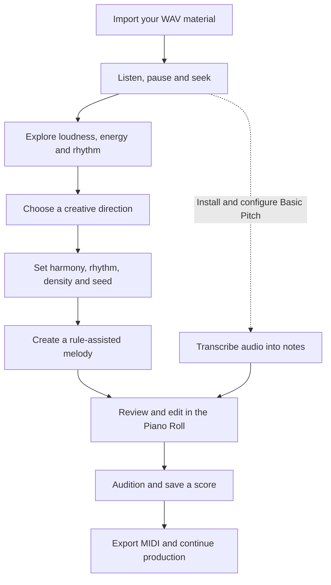
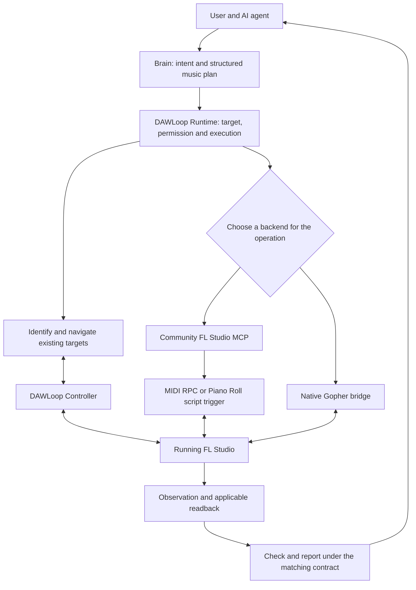
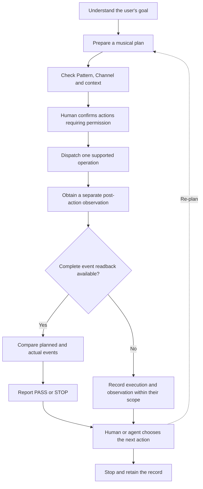

<p align="center"></p>

# DAWLoop

**Turn musical intent into a production workflow you can inspect and build on.**

DAWLoop is an open framework for AI-assisted music creation and verifiable DAW automation. Music creators can listen, analyze, compose and edit MIDI in a standalone Desktop workspace. Developers can use the Python Runtime to connect musical plans, real FL Studio operations and observations into an agent workflow.

Start with a WAV you want to explore, or a musical part you want to work on in the DAW. One route produces editable notes and MIDI; the other organizes host actions around explicit targets, permission and a record of what happened.

[中文](README.md) | [English](README.en.md)

[](https://github.com/ryurikoneko/DAWLoop/actions/workflows/ci.yml)
[](LICENSE)
[](docs/DESKTOP.md)

[Download Desktop Alpha](https://github.com/ryurikoneko/DAWLoop/releases/tag/v0.5.6-alpha.2) · [Try the Runtime](docs/QUICKSTART.md) · [Demos](docs/DEMOS.md) · [Capabilities](docs/CAPABILITIES.md) · [Contribute](CONTRIBUTING.md)


## From musical ideas to editable melodies, all in one workspace

Perhaps you want to understand how a piece builds energy. Perhaps you have a chord progression but no melody you like yet. Music Intelligence brings listening, analysis, rule-assisted composition and note editing together: understand your material, then choose the change you want to make.

### Listen to the material and explore its changes

Import your WAV, play or pause it, and seek to an interesting point. The analysis report offers loudness, energy and rhythmic changes, along with key candidates. For example, explore a transition from a quiet passage to a busy one before deciding whether your new melody should leave space or become more active.

Save useful reports explicitly and reopen them from the saved-results list. Estimated rhythm and key information is presented as reference material; creative choices remain yours.

### Create candidates with constraints, then make them your own

Set the key, chord progression, rhythmic tendency, length and density. Rule-assisted composition uses those constraints to organize notes: harmony guides note choices, rhythm guides placement, and density changes how active the phrase is. Change the seed to explore another candidate, or keep the same settings for comparison.

Continue into the Piano Roll. Select one or several notes, move pitch and start time, change duration or velocity, undo an edit, and audition the phrase. Name and save a score you want to keep, or export MIDI for your production project. A generated candidate becomes material you can shape further.

### Extract notes you can inspect and adjust

To explore an existing instrumental melody, install and configure Basic Pitch in Component Manager, then send the transcription to the same Piano Roll. Read the component terms and confirm installation first, check its state, and start transcription. Review, edit and export the resulting notes as part of your own musical process.



Solid lines show the standalone listening, composition and editing workflow; the dotted branch is optional transcription. Analysis informs your decisions, while you choose the composition settings. The arrows do not imply automatic analysis-to-composer parameter mapping.

<details>
<summary>Explore analysis, Piano Roll editing and component management</summary>


</details>

## Beyond MIDI generation: bringing AI actions into FL Studio

Suppose you are preparing a new melody for an instrument. Along with the notes, you want the agent to know which Pattern and Channel to work on, and what actually happened in the host. DAWLoop's Runtime provides musical plans, target checks, execution adapters and observation records for that kind of task.

This is a separate developer entry point: configure an execution backend and connect your own agent to a running FL Studio environment. Desktop editing and Runtime host actions have their own workflows, connected by a project direction built around musical intent and explicit targets.

### From a musical goal to an operation plan

The agent first makes the request concrete: expected notes, positions, durations, velocities, the intended part and the permitted action. DAWLoop Core expresses these through musical grids, absolute ticks and Note Plans, turning “add a short phrase in the next bar” into data that can be checked.

| A common MIDI-file workflow | An agent workflow inside the host |
| --- | --- |
| Generate MIDI, retrieve the file and import it | The agent submits a structured musical plan |
| The user chooses an instrument, position and destination | Runtime checks the target and context |
| The user inspects the DAW and adjusts the result | A backend dispatches a supported action; an observer records the outcome |
| Generate again or edit manually | A human or agent chooses whether to continue, re-plan or stop |

The comparison describes two ways to organize the work. Each real host path runs under its own target, permission and observation contract.

### Know the Pattern and Channel before acting

The Pattern identifies the musical segment being edited; the Channel identifies its instrument. A selected Channel Rack row is only one part of establishing which Piano Roll is actually open.

DAWLoop Controller reads project context, Pattern number and name, global Channel index and name, PPQ and the loaded session. Navigation to existing targets follows “select an existing Pattern → exclusively select the Channel → open its Piano Roll.” Identity reads before and after navigation accompany UI observation to establish the visible target. Navigation and creation are managed as distinct capabilities.

### What carries the action into FL Studio?

The pinned Community FL Studio MCP exposes transport, Channel, Piano Roll, Mixer and loaded-plugin parameter tools. DAWLoop adds plans, target checks, result conversion and verification policy around those interfaces; its own Controller supplies identity and navigation. A separate Native research path uses the Gopher bridge for constrained operations, preserving human preview and acceptance.



This architecture follows responsibilities in the source. Controller target access, Community tools and the Native bridge have different roles and call/readback paths. Community Piano Roll operations also use a request queue, host-script triggering and state files, described in the integration guide.

### After sending an action, what else matters?

An acknowledgement tells you something about execution. To check a musical goal, the workflow also needs to establish where the action landed, what actual state is available, and how that state relates to the original plan.

When complete event readback is available, the Exact-Set comparator checks start, duration, pitch, velocity and duplicate counts. **PASS** means the relevant rules have enough evidence and their conditions are satisfied. **STOP** means a mismatch, ambiguous target or missing evidence prevents the workflow from continuing under those rules. Execution and observation also retain their own states and scope.



The diagram explains how an agent uses feedback. Full event comparison and scoped observation records remain distinct, with human review before actions requiring permission. A subsequent attempt gets a new plan and record, preserving earlier outcomes.

### A constrained operation that actually ran

In a dedicated test project, the maintainer selected existing Pattern 1 and 808 Kick, preparing a fixed 16-note phrase in bars 5–8 at PPQ 96. Runtime checked context, organized navigation and dispatched one controlled operation. The user reviewed the host preview and accepted it manually; application observation and a completion callback followed, and the user confirmed the audible result.

The public record retains one dispatch, zero retries, zero fallback and its actual terminal state, `COMPLETED_UNVERIFIED`. It shows how real-host execution, human acceptance and observation fit together; full event-set comparison remains `NOT_VERIFIED` in that same record.

Before a host experiment, back up data, use an authorized disposable test project, and confirm the Pattern, Channel and operation scope. Installing a backend does not grant permission to write into the current song.

[Read the complete story](docs/DEMOS.md) · [Public source record](evidence/public/fast_session_7.json) · [Execution paths and message sequence](docs/FL_STUDIO_MCP.md) · [Deployment and permissions](docs/DEPLOYMENT.md)

## Why bring these capabilities together?

**From plans to actions:** structured musical intent can be handed to execution adapters and supported backends inside a real DAW.

**From actions to checked results:** targets, acknowledgements, observations and verification findings remain distinct. An agent can reason about its next step using that information rather than a single success string.

**From analysis to editing:** creators get a standalone listening and editing workspace; developers get an extensible Runtime. Brain organizes plans and rules, Hands connects the host, and Ears supplies MIDI, orchestration and audio analysis for the next production decision.

[Architecture](docs/ARCHITECTURE.md) · [Production Pipeline](docs/PRODUCTION_PIPELINE.md) · [Capabilities and source](docs/CAPABILITIES.md)

## Get started

### Music creators: download Desktop

[Windows x64 Portable ZIP](https://github.com/ryurikoneko/DAWLoop/releases/download/v0.5.6-alpha.2/DAWLoop%2B0.5.6-alpha.2-Windows-x64-Portable.zip) · [Release notes and checksums](https://github.com/ryurikoneko/DAWLoop/releases/tag/v0.5.6-alpha.2)

The application is unsigned. Verify the official source and `SHA256SUMS.txt` before running it, keep system security protections enabled, and back up user data before upgrading.

1. Extract the complete program directory and run `DAWLoop.exe`.
2. In Music Intelligence → Component Manager, read the terms and confirm installation of basic components; add Basic Pitch when you want transcription.
3. Import a WAV to listen and analyze, or create a melody, edit it in the Piano Roll, save and export MIDI.

The [Desktop guide](docs/DESKTOP.md) explains the UI steps. System Python, Node and Codex are unnecessary.

### Developers: start with a Runtime example

Python 3.11+. This synthetic example produces analysis, profiles and a musical plan:

```powershell
git clone https://github.com/ryurikoneko/DAWLoop.git
cd DAWLoop
python -m venv .venv
.\.venv\Scripts\python.exe -m pip install -e ".[learning]"
.\.venv\Scripts\python.exe learning/examples/generic_learning/run.py --output workspace/personal/demo-v1
```

On Linux/macOS use `python3 -m venv .venv` and `.venv/bin/python`. Choose a new output directory for each run.

[Quickstart](docs/QUICKSTART.md) · [FL Studio setup](docs/FL_STUDIO_SETUP.md) · [Contribute](CONTRIBUTING.md) · [Roadmap](docs/ROADMAP.md)

## Open source and credits

Project-authored code uses the [MIT License](LICENSE). Branding and certain images have separate notices in the [brand policy](TRADEMARKS.md), [license scope](LICENSE_POLICY.md) and [media guide](docs/media/README.md).

Thanks to [karl-andres/fl-studio-mcp](https://github.com/karl-andres/fl-studio-mcp) for community FL Studio control, and Bilibili creator [坏影子不坏](https://space.bilibili.com/599132499) (UID 599132499) for the [DSH workflow demonstration](https://www.bilibili.com/video/BV1PTht6cENP/). Those practices influenced the Production Pipeline; some generalized analysis code is adapted from the supplied MIT-licensed `whale-music-pipeline`, retaining original notices.

[Acknowledgements](docs/ACKNOWLEDGEMENTS.md) · [Third-party notices](THIRD_PARTY_NOTICES.md) · [Provenance](PROVENANCE.md) · [Security](SECURITY.md) · [Glossary](docs/GLOSSARY.md)

## Current Version Notes

- Desktop **0.5.6-alpha.2** is a public Windows x64 Pre-release. It has maintainer-environment records; independent clean-Windows compatibility awaits confirmation, and the binary is unsigned.
- Basic analysis supports WAV. Basic Pitch can be installed after license confirmation and is intended for instrument material, with musical review of the transcription.
- Desktop and Python Runtime are separate deliveries. Host diagrams describe the working model; fixed live-test scope is recorded in [Verification](docs/VERIFICATION.md).
- General autonomous production, continuous arbitrary-project control and full automatic mixing remain [future directions](docs/ROADMAP.md).
- Screenshots show an earlier development build. Desktop source is at the [Alpha.2 tag](https://github.com/ryurikoneko/DAWLoop/tree/v0.5.6-alpha.2), Runtime on main. Update reminders match version, channel and owner approval; they do not install updates automatically.
