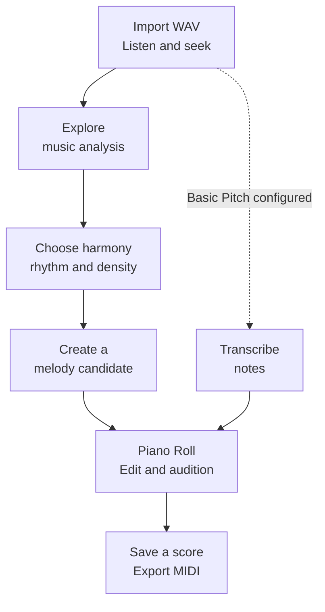
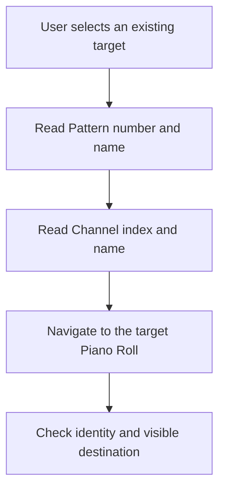
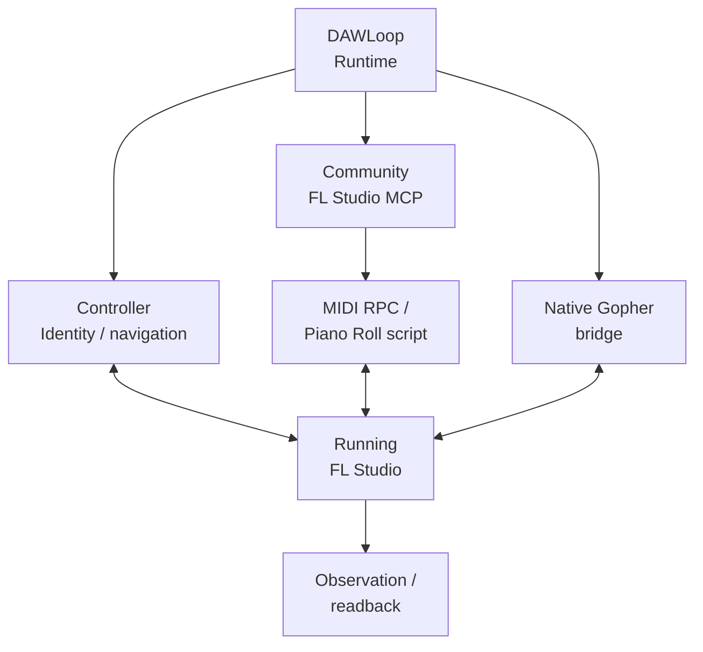
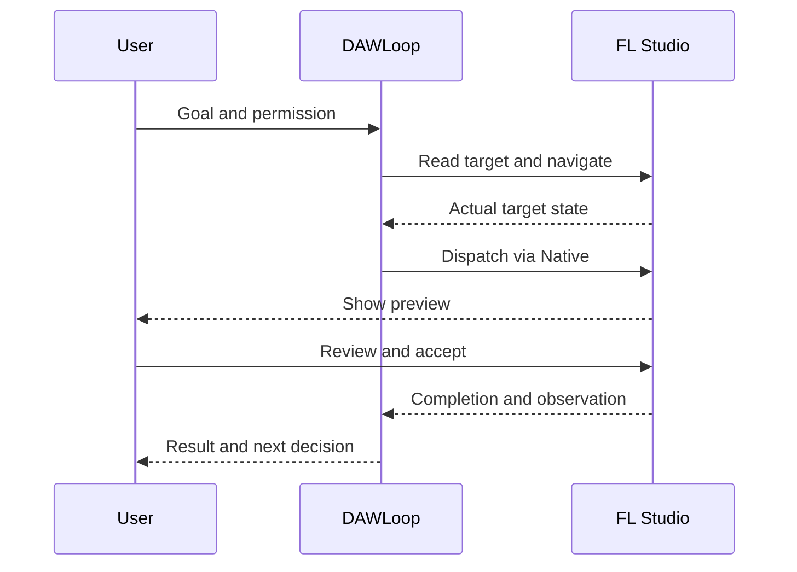
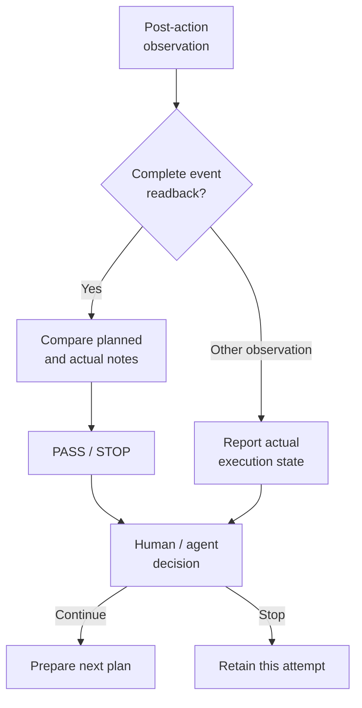

# DAWLoop

**AI-assisted music creation, connected to real DAW workflows.**

Analyze music, shape melodies and edit MIDI in one workspace. Build AI agents that act inside real FL Studio, observe results and verify the next step.

[中文](README.md) | [English](README.en.md)

[](https://github.com/ryurikoneko/DAWLoop/actions/workflows/ci.yml)
[](LICENSE)
[](docs/DESKTOP.md)

[Download Desktop Alpha](https://github.com/ryurikoneko/DAWLoop/releases/tag/v0.5.6-alpha.2) · [Try the Runtime](docs/QUICKSTART.md) · [Demos](docs/DEMOS.md) · [Capabilities](docs/CAPABILITIES.md) · [Contribute](CONTRIBUTING.md)


## From musical material to an editable melody

Study how a piece changes, or find a melody for an existing harmony. Music Intelligence brings listening, analysis, creation and editing into one workspace.

### Import and analyze music

Import your WAV, listen and seek to an interesting passage, then explore levels, energy, rhythm changes and key candidates. Find where a backing part becomes busier before deciding whether your melody should leave space or become more active.


Interpret the report alongside listening. Save useful analyses and reopen them from the list. Rhythm and key candidates inform your creative choices.

### Create and shape a melody

Set key, harmony, rhythm, length, density and seed to create a rule-assisted melody. With Basic Pitch installed and configured, you can also transcribe notes from instrumental audio.


Select and move notes, change pitch, start, duration and velocity, audition the phrase and undo changes. Name and save a score you want to keep, then export MIDI for further instrument and arrangement work.

### Prepare the components you need

Component Manager shows installation requirements and availability. Review the terms and confirm installation, then prepare basic analysis or Basic Pitch transcription for your task.


### The complete Desktop workflow



Reports inform your direction; you choose composition settings and edits. Optional transcription and rule-based creation lead into the same note-editing workflow.

## Bring AI actions into real FL Studio

When you ask an agent to prepare a phrase for an instrument, the task can continue into the running DAW. DAWLoop structures the plan, establishes the destination, connects the execution backend to FL Studio and brings results back for the next decision.


1. Describe the goal: choose the instrument and passage you want to change.
2. Prepare the plan: specify notes, timing, durations and permitted bounds.
3. Identify the target: check Pattern, Channel and project context.
4. Execute: dispatch an authorized host action through the selected backend.
5. Observe: obtain actual state and applicable readback.
6. Decide: continue, re-plan or stop using the report.

### Where should the notes go?

The Pattern identifies the musical segment; the Channel identifies its instrument. Controller reads actual identity, while Runtime navigates existing objects and uses UI observation to establish the Piano Roll destination.



### What carries the operation into FL Studio?

Community FL Studio MCP exposes transport, Channel, Piano Roll, Mixer and loaded-plugin parameter tools. DAWLoop adds musical plans, target management and evaluation. Native Gopher provides a separate execution path; Controller identity and navigation support target preparation.



The branches serve target preparation, Community tools and Native actions. Actual calls follow the chosen backend into the host.

### How do execution and feedback connect?

This Native sequence starts with a task and destination, then dispatches the operation. The user reviews the host preview before completion information and application observation return to the workflow.



### How does the agent decide what comes next?

An acknowledgement describes execution; actual readback supports checking the musical goal. With complete note events, Exact-Set compares start, duration, pitch, velocity and multiplicity to return PASS / STOP. Other observations are reported under the matching operation rules.



### A real FL Studio note-write test

DAWLoop has completed a real FL Studio note-write test and passed acceptance.


The illustration follows the public test record and synthetic plan. See the [operation story](docs/DEMOS.md), [public record](evidence/public/fast_session_7.json) and [execution paths](docs/FL_STUDIO_MCP.md) for their sources.

## Why bring these capabilities together?

- From plans to actions: structure musical intent and reach the real DAW through a backend.
- From actions to evaluation: use targets, execution information and observations to choose the next step.
- From analysis to editing: create in Desktop and extend agent workflows through Runtime.

[Architecture](docs/ARCHITECTURE.md) · [Production Pipeline](docs/PRODUCTION_PIPELINE.md) · [Capabilities and source](docs/CAPABILITIES.md)

## Get started

### Music creators: download Desktop

[Windows x64 Portable ZIP](https://github.com/ryurikoneko/DAWLoop/releases/download/v0.5.6-alpha.2/DAWLoop%2B0.5.6-alpha.2-Windows-x64-Portable.zip) · [Release notes and checksums](https://github.com/ryurikoneko/DAWLoop/releases/tag/v0.5.6-alpha.2)

The application is unsigned. Verify the official source and `SHA256SUMS.txt` before running it, keep system security protections enabled, and back up user data before upgrading.

1. Extract the complete program directory and run `DAWLoop.exe`.
2. In Music Intelligence → Component Manager, read the terms and confirm installation of basic components; add Basic Pitch when you want transcription.
3. Import a WAV to listen and analyze, or create a melody, edit it in the Piano Roll, save and export MIDI.

The [Desktop guide](docs/DESKTOP.md) explains the UI steps. System Python, Node and Codex are unnecessary.

### Developers: start with a Runtime example

Python 3.11+. This synthetic example produces analysis, profiles and a musical plan:

```powershell
git clone https://github.com/ryurikoneko/DAWLoop.git
cd DAWLoop
python -m venv .venv
.\.venv\Scripts\python.exe -m pip install -e ".[learning]"
.\.venv\Scripts\python.exe learning/examples/generic_learning/run.py --output workspace/personal/demo-v1
```

On Linux/macOS use `python3 -m venv .venv` and `.venv/bin/python`. Choose a new output directory for each run.

[Quickstart](docs/QUICKSTART.md) · [FL Studio setup](docs/FL_STUDIO_SETUP.md) · [Contribute](CONTRIBUTING.md) · [Roadmap](docs/ROADMAP.md)

## Open source and credits

Project-authored code uses the [MIT License](LICENSE). Branding and certain images have separate notices in the [brand policy](TRADEMARKS.md), [license scope](LICENSE_POLICY.md) and [media guide](docs/media/README.md).

Thanks to [karl-andres/fl-studio-mcp](https://github.com/karl-andres/fl-studio-mcp) for community FL Studio control, and Bilibili creator [坏影子不坏](https://space.bilibili.com/599132499) (UID 599132499) for the [DSH workflow demonstration](https://www.bilibili.com/video/BV1PTht6cENP/). Those practices influenced the Production Pipeline; some generalized analysis code is adapted from the supplied MIT-licensed `whale-music-pipeline`, retaining original notices.

[Acknowledgements](docs/ACKNOWLEDGEMENTS.md) · [Third-party notices](THIRD_PARTY_NOTICES.md) · [Provenance](PROVENANCE.md) · [Security](SECURITY.md) · [Glossary](docs/GLOSSARY.md)

## Current Version Notes

- Desktop **0.5.6-alpha.2** is a public Windows x64 Pre-release. It has maintainer-environment records; independent clean-Windows compatibility awaits confirmation, and the binary is unsigned.
- Basic analysis supports WAV. Basic Pitch can be installed after license confirmation and is intended for instrument material, with musical review of the transcription.
- Desktop and Python Runtime are separate deliveries. Host diagrams describe the working model; fixed live-test scope is recorded in [Verification](docs/VERIFICATION.md).
- General autonomous production, continuous arbitrary-project control and full automatic mixing remain [future directions](docs/ROADMAP.md).
- Screenshots show an earlier development build. Desktop source is at the [Alpha.2 tag](https://github.com/ryurikoneko/DAWLoop/tree/v0.5.6-alpha.2), Runtime on main. Update reminders match version, channel and owner approval; they do not install updates automatically.
