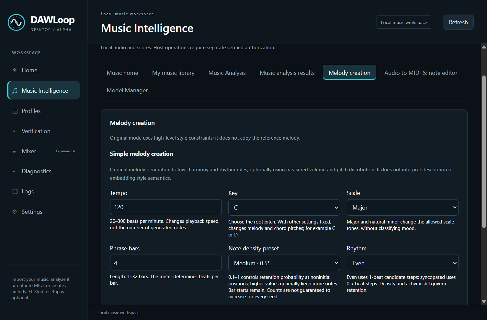

<p align="center"></p>

<p align="center"></p>

# DAWLoop

**音乐智能、MIDI 编辑与有证据边界的 DAW 自动化。**

[中文](README.md) | [English](README.en.md)

[](https://github.com/ryurikoneko/DAWLoop/actions/workflows/ci.yml)
[](LICENSE)
[](docs/CAPABILITIES.md)

[开始使用](#开始使用) · [Desktop 预览](docs/DESKTOP.md) · [能力与证据](docs/CAPABILITIES.md) · [架构](docs/ARCHITECTURE.md) · [路线图](docs/ROADMAP.md) · [贡献](CONTRIBUTING.md)

[KNOWN｜HIGH] DAWLoop 把音乐素材、结构化计划、编辑和受控宿主操作连接起来。公开仓库目前提供 Runtime / Agent 工程；单窗口 Desktop / Music Intelligence 正在独立功能树中开发。

> **Alpha / Internal Preview，不是稳定发行版。**
> [COMPUTED｜HIGH] 本页核验基准：公开 `main` 为 `1a99482`；Desktop 实测源码为 `66806b5`，候选为 `0.5.6-internal.1`。截至 2026-10-13，公开 Releases 只有 Python Alpha 包，没有该 Desktop 安装包。页面截图中的版本属于内部候选，不是 Python Runtime 版本。详见 [Desktop 状态](docs/DESKTOP.md)。

## 看见正在开发的产品

[COMPUTED｜HIGH] 以下是实际运行的内部候选，使用自有合成测试素材；不是设计稿，也不是公开版安装承诺。



<details>
<summary>查看真实音乐分析报告与 Piano Roll</summary>


</details>

[截图来源与隐私审查](docs/media/README.md) · [两个独立演示场景](docs/DEMOS.md)

## 核心功能

| 方向 | 可以了解或体验什么 | 当前交付范围 |
| --- | --- | --- |
| 音乐分析 | 导入音频、基础测量、响度、调性候选与时间曲线 | 内部 Desktop 特定场景实测；估计值不等于确定结论 |
| 音频转 MIDI | Basic Pitch 转录、审阅音符、编辑与导出 | 内部候选实测；复杂混音不等于完整多轨分离 |
| 旋律创作 | 和声、节奏、密度与 Seed 约束生成 | 规则引擎 `RULE_BASED`，不是大模型推理 |
| MIDI 编辑 | Piano Roll、力度、撤销、试听与 MIDI 读回 | 内部候选实测 |
| Runtime / Agent | 音乐计划、离线验证、目标门控、人工接受与观察 | 公开 main；受限 FAST 有历史现场证据 |
| 模型管理 | 独立 Worker、安装状态、版本和失败原因 | 内部候选；不保证干净 Windows 首装完成 |

## 当前能力与验证范围

[KNOWN｜HIGH] **公开代码、内部候选、离线通过、特定场景现场通过、实验性、尚未验证、计划中和阻塞是不同状态。** 完整清单以 [统一能力表](docs/CAPABILITIES.md) 为准。

- [KNOWN｜HIGH] 已有 Native FAST 现场闭环：固定 16-note、一次派发、人工 Accept、应用观察与完成回调；结果仍是 `COMPLETED_UNVERIFIED`。[公开脱敏证据](evidence/public/fast_session_7.json)
- [KNOWN｜HIGH] 新 Desktop Host / Session、真实 Mixer 和任意工程写入没有在本页获得认证；不会因为展示 UI 就开放权限。
- [KNOWN｜HIGH] OMAR-RQ Embedding 提取不等于艺术家风格学习；相似检索与风格识别仍需独立实现、评估和授权。
- [KNOWN｜HIGH] 自动接受、完整自动混音、自动驾驶式 Agent、YuE2 完整生成均不是当前已认证的产品能力。

## 开始使用

### 音乐创作者

[KNOWN｜HIGH] 想直接使用桌面界面：先读 [Desktop 预览说明](docs/DESKTOP.md)。目前没有可在公开 Releases 下载的新版 Desktop；不要把 Runtime 的 wheel 当作桌面安装包，也不要依赖未审查的第三方镜像。未来正式候选将单独说明组件、模型许可和安装要求。

### 开发者：先跑无宿主离线教程

[KNOWN｜HIGH] 公开源码需要 Python 3.11+。以下教程使用合成素材，不启动 FL Studio：

```powershell
git clone https://github.com/ryurikoneko/DAWLoop.git
cd DAWLoop
python -m venv .venv
.\.venv\Scripts\python.exe -m pip install -e ".[learning]"
.\.venv\Scripts\python.exe learning/examples/generic_learning/run.py --output workspace/personal/demo-v1
```

[KNOWN｜HIGH] Linux/macOS 使用 `.venv/bin/python`。再次运行选择新的输出目录。[Quick Start](docs/QUICKSTART.md) · [部署与依赖](docs/DEPLOYMENT.md) · [Runtime 工程指南](docs/RUNTIME_GUIDE.zh.md)

### FL Studio 研究集成

[KNOWN｜HIGH] 按 [部署合同](docs/DEPLOYMENT.md) 配置独立测试工程、Controller 与真实观察入口。公开包安装成功不等于当前工程可写；必须保留目标、代次、来源、预算和人工接受门。上游 Community adapter 与 Native FAST 分别验证。

## 架构与主要组件

```text
公开 Runtime / Agent       音乐合同 → 验证 → 受控 FAST → 观察与人工审阅
内部 Desktop               Renderer → Preload → 受控 IPC → Adapter / Worker
未来宿主集成               受信来源 → 会话与目标绑定 → Publisher → Desktop
```

[KNOWN｜HIGH] 三条路线的发布和认证分别管理。Desktop 不直接调用 FL 私有实现；模型不运行在 Renderer；通用 MusicalPlan → FAST 的单位与字段转换仍待独立接线。[完整架构](docs/ARCHITECTURE.md)

## 接下来

- [INFERRED｜HIGH] 独立交付 Desktop 可安装候选、可信离线组件和干净 Windows 验收。
- [INFERRED｜HIGH] 按互斥宿主租约逐级验证 Host / Session、Mixer 结构和插件只读能力。
- [INFERRED｜HIGH] 在单独授权与证据门下研究参考检索、音乐学习及生成模型；Embedding 语义不靠宣传补齐。
- [INFERRED｜HIGH] 将通用音乐计划接入已有限定 FAST 流程，保留人工确认和验证边界。

[完整路线图](docs/ROADMAP.md) · [验证规则](docs/VERIFICATION.md) · [历史 Runtime 状态](docs/DAWLOOP_RUNTIME_V2.md#current)

## 贡献、许可与致谢

[KNOWN｜HIGH] 自有代码与公共技术文档继续使用 [MIT](LICENSE)。**正式 Logo 与 Splash / Hero 图片受版权保护，并按精确资产清单单独保留品牌权利**；代码 MIT 不代表可冒充官方品牌。[品牌政策](TRADEMARKS.md) · [许可范围](LICENSE_POLICY.md) · [媒体声明](docs/media/README.md)

[KNOWN｜HIGH] 保留 [karl-andres/fl-studio-mcp](https://github.com/karl-andres/fl-studio-mcp) 的固定 MIT 快照与原作者通知；Bilibili 创作者 [坏影子不坏](https://space.bilibili.com/599132499) 的 [DSH 工作流展示](https://www.bilibili.com/video/BV1PTht6cENP/)及 `whale-music-pipeline` 是 Production Pipeline 的实践与代码来源。灵感、代码许可和私人素材权利分别登记。

[贡献](CONTRIBUTING.md) · [安全报告](SECURITY.md) · [第三方声明](THIRD_PARTY_NOTICES.md) · [完整致谢](docs/ACKNOWLEDGEMENTS.md) · [来源](PROVENANCE.md) · [NOTICE](NOTICE) · [AUTHORS](AUTHORS) · [引用](CITATION.cff)

[KNOWN｜HIGH] 历史 FLSkill → DAWProof → DAWLoop 的提交、标签和 Release 保留；较长工程说明已移至 [Runtime 指南](docs/RUNTIME_GUIDE.zh.md)，不以首页简化删去证据。
