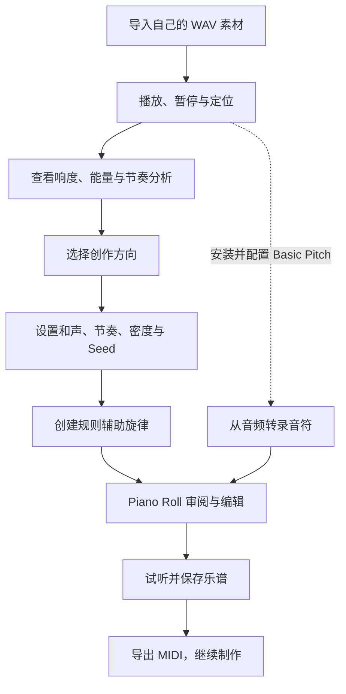
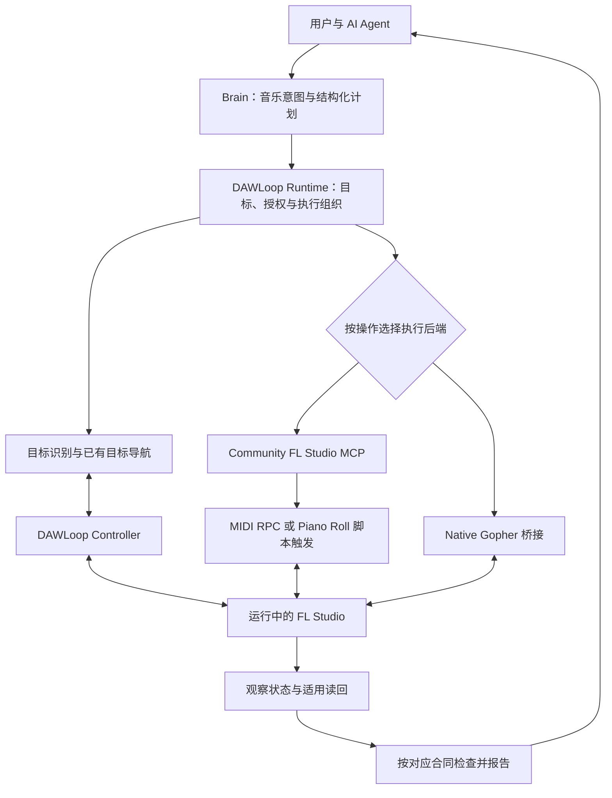
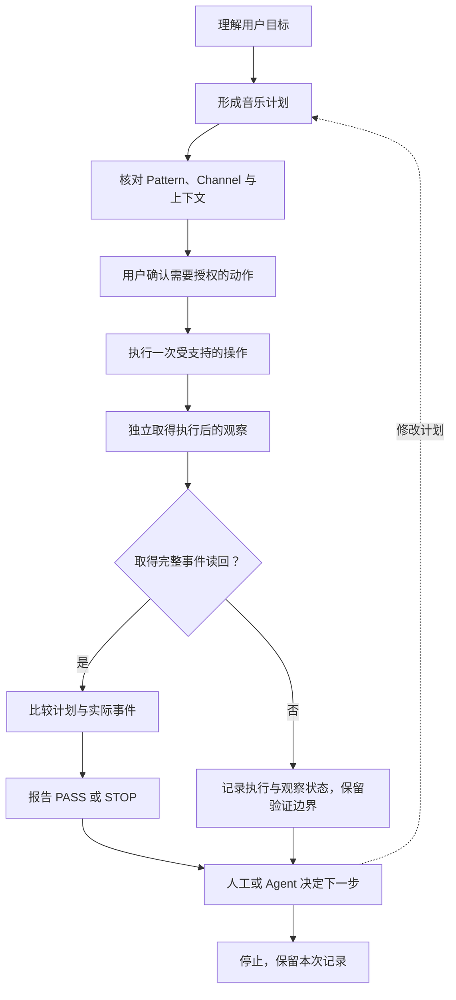

<p align="center"></p>

# DAWLoop

**让音乐想法进入可观察、可继续的制作流程。**

DAWLoop 是面向 AI 辅助音乐创作与可验证 DAW 自动化的开放框架。音乐创作者可以在独立 Desktop 工作区试听素材、分析音乐、创建旋律和编辑 MIDI；开发者可以通过 Python Runtime，把音乐计划、真实 FL Studio 操作与结果观察组织成 Agent 工作流。

你可以从一个 WAV 素材开始，也可以从正在制作的乐器声部开始。前者通向可编辑的音符与 MIDI，后者通向目标明确、需要确认、能够留下操作记录的宿主交互。

[中文](README.md) | [English](README.en.md)

[](https://github.com/ryurikoneko/DAWLoop/actions/workflows/ci.yml)
[](LICENSE)
[](docs/DESKTOP.md)

[下载 Desktop Alpha](https://github.com/ryurikoneko/DAWLoop/releases/tag/v0.5.6-alpha.2) · [体验 Runtime](docs/QUICKSTART.md) · [使用场景](docs/DEMOS.md) · [功能目录](docs/CAPABILITIES.md) · [参与贡献](CONTRIBUTING.md)


## 一个工作区，从音乐素材到可编辑旋律

你可能想研究一段音乐的能量起伏，也可能已经有了和声，却还没有满意的旋律。Music Intelligence 把素材试听、音乐分析、规则辅助创作和音符编辑放在一起：先理解你手中的材料，再决定自己想做出的改变。

### 听见素材，再读懂变化

导入自己的 WAV，在工作区播放、暂停并定位到感兴趣的位置。分析报告提供响度、能量与节奏变化、调性候选等参考，让你有依据地选择要继续研究的部分。例如，先找出从平静走向密集的段落，再决定新旋律应该保持空间，还是增加活动感。

分析结果可以主动保存，之后从保存列表重新打开。估计性的节奏与调性信息作为候选呈现；创作上的取舍由你决定。

### 用约束创建候选，用编辑形成自己的旋律

输入调性、和声进行、节奏倾向、长度与密度，规则辅助创作会据此组织音符。和声影响候选音的选择，节奏条件影响落点，密度影响音符活动程度；改变 Seed 可以探索另一组候选，保留相同设置便于比较。

生成以后继续进入 Piano Roll：选择一个音符或一组音符，移动音高和起点、调整时值与力度，撤销不合适的修改，再试听乐句。给满意的结果命名并保存乐谱，或导出 MIDI 带入自己的制作工程。这些步骤让候选旋律成为可以继续打磨的材料。

### 从音频提取可以调整的音符

想研究已有乐器旋律时，可以在组件管理中安装并配置 Basic Pitch，再把音频转录到同一个 Piano Roll。先阅读组件许可并确认安装，随后检查组件状态，再开始转录。得到的音符仍可由你审阅、调整与导出。



实线是独立工作区中的试听、创作与编辑流程；虚线是可选转录分支。分析报告帮助你构思，创作设置由你选定；图中的箭头不表示分析报告会自动决定旋律参数。

<details>
<summary>查看分析报告、Piano Roll 与组件管理</summary>


</details>

## 让 AI 参与真实的 FL Studio 工作流

假设你正在为一个乐器准备新的旋律想法。除了得到一份 MIDI 文件，你还希望 Agent 知道应当操作哪个 Pattern、哪一个 Channel，以及这次动作在宿主里实际发生了什么。DAWLoop 的 Runtime 为这类任务提供音乐计划、目标检查、执行适配和观察记录。

这是项目另一条独立入口：开发者配置执行后端，把自己的 Agent 接入运行中的 FL Studio。Desktop 的本地编辑器与 Runtime 宿主操作各有工作流程，音乐计划和明确目标把它们放在同一个项目方向之下。

### 从“想改什么”到“准备怎样操作”

Agent 先把用户意图整理为具体计划：预期音符、节奏位置、持续时间、力度、目标声部以及允许的动作。DAWLoop Core 用音乐网格、绝对 tick 和 Note Plan 表达这些信息，让“在下一小节加一个短句”成为可以检查的操作数据。

| 常见 MIDI 文件流程 | 面向真实宿主的 Agent 工作模式 |
| --- | --- |
| 生成 MIDI，用户获取文件并导入 | Agent 提交结构化音乐计划 |
| 用户选择乐器、位置与接收对象 | Runtime 检查目标与上下文 |
| 用户在 DAW 中检查结果并继续修改 | 执行后端派发受支持的动作，观察者记录结果 |
| 再次生成或手动编辑 | 人工或 Agent 根据报告选择继续、修改计划或停止 |

这张对照表说明两种操作组织方式。具体宿主路径按照各自的目标、授权和观察合同运行。

### 先弄清 Pattern 与 Channel

Pattern 决定当前编辑的片段，Channel 决定片段中的乐器。即便 Channel Rack 选中了某个通道，也仍需要确认打开的 Piano Roll 指向哪里。

DAWLoop Controller 读取当前工程上下文、Pattern 编号与名称、Channel 全局索引与名称、PPQ 和加载会话信息。已有目标导航按“选已有 Pattern → 独占选择 Channel → 定向打开 Piano Roll”组织；前后身份读取与界面观察一起帮助核对实际目标。导航已有对象与创建新对象是分别管理的能力。

### 谁把动作送进 FL Studio？

固定版本的 Community FL Studio MCP 提供 transport、Channel、Piano Roll、Mixer 和已加载插件参数等工具接口。DAWLoop 在这些工具周围补充计划、目标检查、结果转换与验证规则；自有 Controller 提供身份与导航能力。另一个 Native 研究路径通过 Gopher 桥接派发受限操作，并保留人工预览和接受步骤。



这是按源码职责整理的执行架构图。Controller 的目标通道、Community 工具和 Native 桥接并行分工；不同操作使用不同的调用及回读路径。Community Piano Roll 还涉及请求队列、宿主脚本触发和状态文件，详见连接指南。

### 操作已发送之后，还需要知道什么？

工具回报请求已接收，回答的是执行过程中的一个问题；音乐目标是否达成，还需要观察动作落到了哪里、取得什么实际状态，以及这些信息能否与原计划对应。

具备完整事件读回时，Exact-Set 比较器会核对计划与实际音符的起点、时值、音高、力度和重复次数。**PASS** 表示对应规则下取得了足够依据并满足条件；**STOP** 表示出现差异、目标不明确或缺少继续判断所需的信息。执行与观察记录也有各自的状态，报告会保留它们的真实范围。



这张图解释 Agent 如何使用反馈。完整事件比较与限定观察记录分别报告，人工审阅保留在需要授权的动作之前。后续尝试形成新的计划和记录，保留此前发生过的结果。

### 一个实际执行过的受限场景

维护者曾在专用测试工程中，选定已有 Pattern 1 和 808 Kick，以 PPQ 96 准备第 5–8 小节的固定 16-note 短句。Runtime 核对上下文，组织目标导航，派发一次受控操作；用户查看宿主预览并人工接受，随后取得应用观察和完成回调，用户也确认试听结果。

公开记录保留了“一次派发、零重试、零 fallback”和实际终态 `COMPLETED_UNVERIFIED`。这份案例展示真实宿主中的执行、人工接受与观察如何衔接；完整音符集合比较的状态在同一记录中保留为 `NOT_VERIFIED`。

运行此类宿主实验前，必须备份数据、使用获准的专用测试工程并确认 Pattern、Channel 和操作范围。安装后端本身不授予对当前作品写入的权限。

[阅读完整操作故事](docs/DEMOS.md) · [原始公开摘要](evidence/public/fast_session_7.json) · [执行原理与消息时序](docs/FL_STUDIO_MCP.md) · [宿主部署与权限](docs/DEPLOYMENT.md)

## 为什么把这些能力放在一起？

**从计划到操作：**结构化音乐意图可以交给执行适配器，由受支持的后端参与真实 DAW 操作。

**从操作到核验：**目标、执行回执、实际观察和验证结论分别保留，Agent 能根据它们判断下一步，而不是只消费一个“成功”字符串。

**从音乐分析到编辑：**创作者有独立的试听与编辑工作区，开发者有可扩展的 Runtime。Brain 组织计划与规则，Hands 连接宿主，Ears 以 MIDI、编排和音频分析为下一轮制作提供信息。

[架构解释](docs/ARCHITECTURE.md) · [Production Pipeline](docs/PRODUCTION_PIPELINE.md) · [功能与源码](docs/CAPABILITIES.md)

## 开始使用

### 音乐创作者：下载 Desktop

[Windows x64 便携版 ZIP](https://github.com/ryurikoneko/DAWLoop/releases/download/v0.5.6-alpha.2/DAWLoop%2B0.5.6-alpha.2-Windows-x64-Portable.zip) · [发行说明与校验和](https://github.com/ryurikoneko/DAWLoop/releases/tag/v0.5.6-alpha.2)

程序未签名。运行前核对官方来源和 `SHA256SUMS.txt`，保留系统安全保护；升级前备份用户数据。

1. 解压完整程序目录并运行 `DAWLoop.exe`。
2. 在 Music Intelligence → 组件管理阅读许可，确认安装基础组件；需要转录时再安装 Basic Pitch。
3. 导入 WAV，试听与分析，或创建旋律进入 Piano Roll，保存并导出 MIDI。

[Desktop 使用指南](docs/DESKTOP.md) 按界面展开每一步，无需安装系统 Python、Node 或 Codex。

### 开发者：先运行 Runtime 例子

Python 3.11+。以下例子使用合成数据，生成分析、profile 与音乐计划：

```powershell
git clone https://github.com/ryurikoneko/DAWLoop.git
cd DAWLoop
python -m venv .venv
.\.venv\Scripts\python.exe -m pip install -e ".[learning]"
.\.venv\Scripts\python.exe learning/examples/generic_learning/run.py --output workspace/personal/demo-v1
```

Linux/macOS 使用 `python3 -m venv .venv` 和 `.venv/bin/python`。每次选择尚不存在的输出目录。

[Quickstart](docs/QUICKSTART.md) · [FL Studio 设置](docs/FL_STUDIO_SETUP.md) · [贡献](CONTRIBUTING.md) · [路线图](docs/ROADMAP.md)

## 开源与致谢

项目自有代码采用 [MIT 许可证](LICENSE)。品牌与部分图像的独立声明见 [品牌政策](TRADEMARKS.md)、[许可范围](LICENSE_POLICY.md) 和 [媒体说明](docs/media/README.md)。

感谢 [karl-andres/fl-studio-mcp](https://github.com/karl-andres/fl-studio-mcp) 的社区 FL Studio 控制工作，以及 Bilibili 创作者 [坏影子不坏](https://space.bilibili.com/599132499)（UID 599132499）的 [DSH 工作流展示](https://www.bilibili.com/video/BV1PTht6cENP/)。其制作实践启发 Production Pipeline；部分通用分析代码改编自其提供的 MIT 许可 `whale-music-pipeline`，保留原作者通知。

[完整致谢](docs/ACKNOWLEDGEMENTS.md) · [第三方通知](THIRD_PARTY_NOTICES.md) · [来源](PROVENANCE.md) · [安全](SECURITY.md) · [术语](docs/GLOSSARY.md)

## 当前版本说明

- Desktop **0.5.6-alpha.2** 是公开 Windows x64 Pre-release；维护者环境已有运行记录，独立干净 Windows 兼容性仍待确认，程序未签名。
- 基础分析支持 WAV；Basic Pitch 可在确认许可后安装，适合乐器素材，转录结果需要音乐审阅。
- Desktop 与 Python Runtime 分别交付；本文宿主图说明工作模式，具体 FL 现场范围以固定测试记录和 [验证文档](docs/VERIFICATION.md) 为准。
- 通用自主制作、任意工程连续控制及完整自动混音属于 [后续方向](docs/ROADMAP.md)。
- 截图来自此前开发版本；Desktop 源码见 [Alpha.2 标签](https://github.com/ryurikoneko/DAWLoop/tree/v0.5.6-alpha.2)，Runtime 在 main。更新提示仅按版本、渠道与维护者批准匹配，不自动安装。
