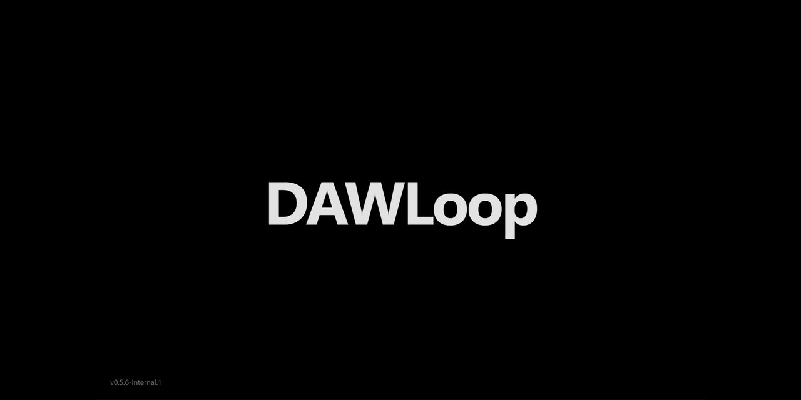

# DAWLoop

**面向音乐创作的智能工具，以及让 AI 操作 DAW 更可控的开放框架。**

DAWLoop 探索如何把音乐分析、MIDI 创作和 DAW 自动化连接起来：从整理素材、生成编辑计划，到执行操作、观察结果。它的设计重点是让 AI 不只发出指令，还能在受支持的工作流中检查发生了什么。

目前项目有两个独立入口：**已公开的 Python Runtime / Agent 工具**，以及**仍在内部预览的 Desktop 音乐工作区**。两者的可用范围不同，不能视为已经整合完成的产品。

[中文](README.md) | [English](README.en.md)

[快速开始](#快速开始) · [Desktop 预览](docs/DESKTOP.md) · [能力与验证范围](docs/CAPABILITIES.md) · [架构](docs/ARCHITECTURE.md) · [路线图](docs/ROADMAP.md)

## 看看 DAWLoop Desktop

下面展示的是正在开发的 Desktop 内部候选，使用自有合成测试素材拍摄，**不是设计效果图，也不代表已经开放下载**。

查看更多：音频分析、Piano Roll 与模型管理

[查看 Desktop 说明](docs/DESKTOP.md) · [演示场景](docs/DEMOS.md) · [截图来源](docs/media/README.md)

## 可以用 DAWLoop 做什么？

| 方向 | 主要内容 | 当前可用范围 |
| --- | --- | --- |
| 音乐分析 | 观察音频的响度、时间变化和速度、调性候选 | Desktop 内部预览；估计值并非确定结论 |
| 音频转 MIDI | 借助 Basic Pitch 转录音符，再审阅、编辑和导出 | Desktop 内部预览；不等于复杂混音的完整分轨 |
| MIDI 创作与编辑 | 规则辅助旋律创作、Piano Roll、力度、撤销与试听 | Desktop 内部预览；旋律生成目前基于规则 |
| 音乐计划与验证 | 描述音符、节奏和目标，比较计划与读回的结果 | Python Runtime 已公开；核心验证有离线测试 |
| FL Studio 自动化研究 | 在指定测试场景中连接控制、人工确认与操作观察 | 实验性集成；不提供任意工程的自动写入保证 |

Desktop 的 Piano Roll 是应用内编辑界面，不应与已验证的 FL Studio 宿主写入能力混为一谈。

[查看完整能力清单及证据](docs/CAPABILITIES.md)

## 不只是执行：还要知道结果

DAWLoop 围绕这样的工作流程设计：

~~~text
理解音乐与目标 → 制定计划 → 执行受支持的操作
                                  ↓
                         观察状态 → 核对结果
                                  ↓
                         人工或 Agent 决定下一步
~~~

例如，写入 MIDI 事件后，仅有“命令执行成功”的回复还不足以证明音符已经按计划出现。DAWLoop 的验证模块会比较预期与实际事件，并明确报告一致或不一致。

**重要区别：**这套计划与比较机制已在公开 Runtime 中实现并完成离线测试；真实 FL Studio 的写入、读回和完整闭环需要逐项现场验证，不能因为离线测试通过就视为通用能力已验证。

[了解架构](docs/ARCHITECTURE.md) · [验证方法](docs/VERIFICATION.md) · [公开现场证据](evidence/public/README.md)

## 快速开始

### 想使用音乐创作界面？

先浏览 [Desktop 预览与安装状态](docs/DESKTOP.md)。目前**没有公开提供的新版 Desktop 安装包**；[Releases](https://github.com/ryurikoneko/DAWLoop/releases) 中的 Python 包不是 Desktop 安装程序。

### 想试用开源 Runtime？

需要 Python 3.11 或更高版本。下面的示例只使用合成数据，**不需要启动 FL Studio**。

Windows PowerShell：

~~~powershell
git clone https://github.com/ryurikoneko/DAWLoop.git
cd DAWLoop
python -m venv .venv
.\.venv\Scripts\python.exe -m pip install -e ".[learning]"
.\.venv\Scripts\python.exe learning/examples/generic_learning/run.py --output workspace/personal/demo-v1
~~~

Linux / macOS：将上述两处 Python 路径改为 .venv/bin/python。重复运行时请使用新的输出目录。

[入门教程](docs/QUICKSTART.md) · [部署与依赖](docs/DEPLOYMENT.md) · [Runtime 开发指南](docs/RUNTIME_GUIDE.zh.md)

### 想研究 FL Studio 集成？

请从 [部署指南](docs/DEPLOYMENT.md) 和 [FL Studio 设置说明](docs/FL_STUDIO_SETUP.md) 开始，准备独立测试工程，并按文档完成目标确认与人工授权。不要把实验性操作直接用于尚未备份的正式工程。

## 版本与后续计划

**Python Runtime：**源码及 Alpha 发行物已公开，可以从 [GitHub Releases](https://github.com/ryurikoneko/DAWLoop/releases) 获取。

**DAWLoop Desktop：**音乐分析、转录和 MIDI 编辑已有内部运行候选，但独立干净 Windows 安装与所需音频组件的分发验收尚未完成，因此暂不开放公开下载。

接下来会重点完善 Desktop 的安装体验、扩展可验证的 FL Studio 集成，并继续评估音乐分析与生成能力。具体进度与限制以 [路线图](docs/ROADMAP.md) 和 [能力表](docs/CAPABILITIES.md) 为准。

## 开源、贡献与致谢

DAWLoop 项目自有软件代码采用 [MIT 许可证](LICENSE)。第三方代码保留原有许可与署名；项目名称、Logo 和部分展示图片另有使用说明，详见 [品牌政策](TRADEMARKS.md)、[许可范围](LICENSE_POLICY.md) 与 [媒体声明](docs/media/README.md)。

感谢 [karl-andres/fl-studio-mcp](https://github.com/karl-andres/fl-studio-mcp) 的社区 FL Studio 控制工作，以及 Bilibili 创作者 [坏影子不坏](https://space.bilibili.com/599132499) 的 [DSH 工作流分享](https://www.bilibili.com/video/BV1PTht6cENP/)与 whale-music-pipeline 相关实践。具体代码来源、版权和许可见 [第三方声明](THIRD_PARTY_NOTICES.md) 与 [完整致谢](docs/ACKNOWLEDGEMENTS.md)。

欢迎通过 [Issues](https://github.com/ryurikoneko/DAWLoop/issues) 反馈问题，或参照 [贡献指南](CONTRIBUTING.md) 参与开发。[安全报告](SECURITY.md) · [项目来源](PROVENANCE.md) · [引用信息](CITATION.cff)
