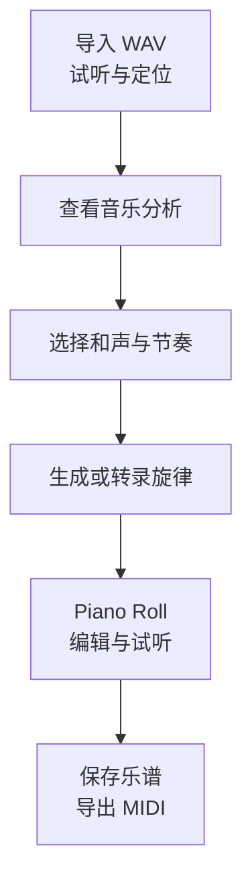
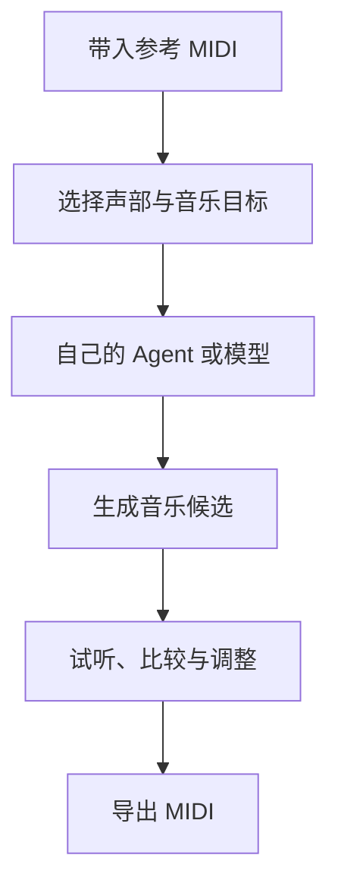
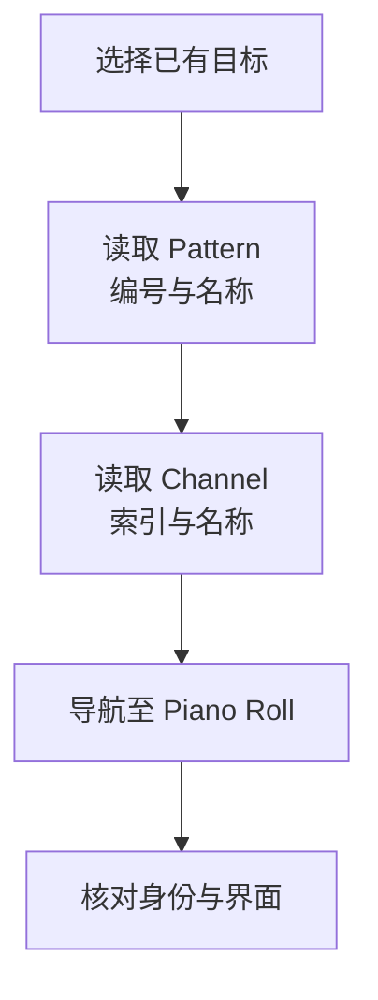
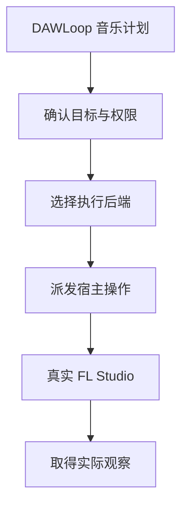
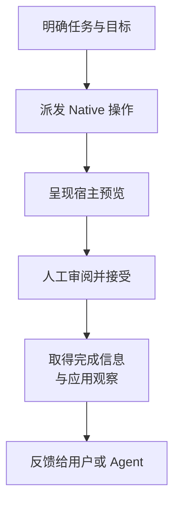
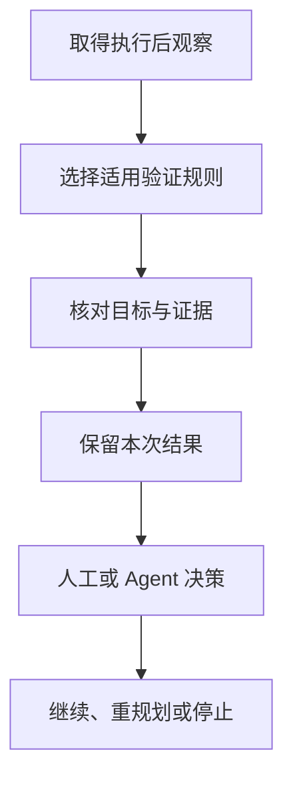

# DAWLoop

**AI Music Creation & DAW Automation**

让音乐创作、AI 智能与真实 DAW 交互融为一体。

在 Desktop 分析素材、创作与编辑 MIDI；在 Plugin 中围绕参考音乐生成和试听候选；用 Runtime 构建能够规划、操作、观察与验证的 Agent 工作流。

[中文](README.md) | [English](README.en.md)

[](https://github.com/ryurikoneko/DAWLoop/actions/workflows/ci.yml)
[](LICENSE)
[](docs/DESKTOP.md)

[下载 Desktop Alpha](https://github.com/ryurikoneko/DAWLoop/releases/tag/v0.5.6-alpha.2) · [下载 Composer VST3](https://github.com/ryurikoneko/DAWLoop/releases/tag/plugin-v0.2.0-rc.1) · [体验 Runtime](docs/QUICKSTART.md) · [使用场景](docs/DEMOS.md) · [功能目录](docs/CAPABILITIES.md) · [参与贡献](CONTRIBUTING.md)


## 选择你的工作入口

| 产品 | 定位与入口 |
|---|---|
| **DAWLoop Desktop — Open Source** | 独立音乐工作区 · [Desktop](docs/DESKTOP.md) |
| **DAWLoop Plugin — Proprietary** | Composer 宿主内创作 · [Plugin](docs/PLUGINS.md) |
| **DAWLoop Runtime — Open Source** | Agent 规划、执行与验证 · [Quickstart](docs/QUICKSTART.md) |

Plugin 与本仓库开源代码分开交付，Composer 已提供 [Windows VST3 预发行版](https://github.com/ryurikoneko/DAWLoop/releases/tag/plugin-v0.2.0-rc.1)。


<br>

---

## DAWLoop Desktop — Open Source

Desktop 是独立运行的音乐工作区，不依赖 DAW。分析素材、创作和编辑音符后，可以导出标准 MIDI，在自己使用的 DAW 中继续制作。

### 一个工作区，从音乐素材到可编辑旋律

研究一段音乐的变化，或为已有和声准备旋律：Music Intelligence 把试听、分析、创作和编辑放在同一个工作区。

### 导入与分析音乐

导入自己的 WAV，试听并定位感兴趣的段落，再查看响度、能量、节奏变化和调性候选。例如，先找出伴奏开始变密的位置，再考虑旋律应该留白还是增加活动感。


结合试听阅读分析结果，保存值得继续研究的报告，之后从列表重新打开。分析帮助你形成创作判断，节奏和调性候选供你参考。

### 创建与修改旋律

设置调性、和声、节奏、长度、密度与 Seed，创建规则辅助旋律；也可以在安装配置 Basic Pitch 后，从乐器音频转录音符。


在 Piano Roll 中选择和移动音符，调整音高、起点、时值与力度，试听并撤销不合适的修改。给满意的乐谱命名保存，导出 MIDI 后继续音色与编排制作。

### 准备需要的组件

组件管理显示安装条件与可用状态。先阅读许可并确认安装，再按任务准备基础分析或 Basic Pitch 转录组件。


### 完整的 Desktop 工作流



分析报告帮助你选择创作方向，具体旋律设置和编辑由你决定。可选转录与规则创作汇入同一个音符编辑工作流。

<br>

---

## DAWLoop Plugin — Composer

**把你的音乐参考、AI 创作伙伴和真实 DAW 放在同一个创作过程里。**

Composer 是运行在宿主中的 VST3 音乐创作工作区。你可以带入已经写好的和弦或旋律，向自己的 AI 描述想法，生成新的音乐候选，在插件里比较、试听和调整，再把 MIDI 带回你使用的 DAW，继续选择音色、编排和制作。

对于已经有灵感但还缺少下一步的创作者，它提供一个可以不断尝试的地方：给和弦寻找主旋律、为乐句探索另一套和声、准备贝斯或琶音方向，或保留参考的节奏重新发展音乐。AI 提供候选，你通过看得见的音符和听得到的对比做选择，逐步形成自己的版本。


Composer 在真实 FL Studio 中的界面：上方组织音乐目标与和声，下方并排查看参考和生成 MIDI，试听与候选切换都留在当前工作区。

### 在你熟悉的 DAW 中创作

当前 Composer 提供 **Windows x64 VST3**，可用于支持该格式的宿主，例如 **FL Studio、Ableton Live、Cubase、REAPER 和 Bitwig Studio**。导入参考 MIDI，在插件中准备、比较和试听候选，再通过标准 MIDI 文件或宿主支持的拖拽方式继续编排。这里的宿主支持依据 VST3 格式兼容性；FL 专用剪贴板、Piano Roll 快照与 Controller 桥接用于 FL Studio 工作流。

### 从已有音乐出发，让 AI 理解你正在写什么

创作可以从一小段音乐开始。把自己的 `.mid` 文件导入参考区，或在 FL Studio Piano Roll 使用 **File → Copy to MIDI clipboard**，再回到 Composer 粘贴。参考音符会出现在时间轴上，成为下一次创作的具体上下文。

你可以把参考设置成和弦、旋律或其他音乐来源，结合音乐参数描述任务。例如，已有一个四小节和声循环时，可以围绕它寻找更简洁的旋律；已有主奏时，可以探索不同的和声与音区安排。参考与候选同时可见，便于判断新的想法怎样接上原有音乐。

配置可选 FL 辅助脚本后，也可以取得当前 Piano Roll 的音符快照，无需先保存工程；Controller 桥接提供工程、Pattern 和 Channel 名称上下文。文件、官方 MIDI 剪贴板与宿主快照让你可以按自己的工作方式带入参考。[输入与宿主接入指南](docs/PLUGINS.md)

### 一个参考，展开多种音乐方向

Composer 将创作目标放在明确的音乐角色上。选择生成方向，再用主提示词和细分设置告诉 AI 需要怎样的结果：

| 生成方向 | 可以怎样参与创作 |
| --- | --- |
| **Chord — 和声** | 为参考探索新的和弦进行、转位与声部安排，比较不同和声色彩 |
| **Lead — 主旋律** | 围绕已有和声准备旋律候选，描述乐句走向、活动感与留白 |
| **Bass — 贝斯** | 探索与和声搭配的低音线，为后续节奏与低频编排提供 MIDI 素材 |
| **Arpeggio — 琶音** | 将和声方向发展为流动的分解音型，寻找不同运动方式 |
| **Pad — 铺底** | 准备持续音与和声铺底方向，在宿主中进一步选择音色与层次 |

例如，你可以提出这样的创作要求：

> 围绕这段和弦准备四小节主旋律，整体温暖，前两小节留白，后两小节增加一点活动感。

也可以保留参考的节奏作为约束，改变目标声部、情绪或音区，继续比较新的版本。这些指令表达你的创作意图；具体候选由接入的 Agent 或模型结合参考与设置产生。

### 和声画布：让音乐结构可以看、可以改

和声画布把和弦按音乐时间排列，而参考区和生成区保留对应的音符视图。你可以沿着小节理解进行，查看候选落在哪个音区、何时进入，以及它与参考在节奏和音高上的关系。

通过和弦编辑、音区设置、时间轴与音高缩放等控件，你可以把“大致合适”的方向推进到更具体的音乐安排。主提示词负责整体目标，Compose、Chord、Emotion 等分区提供进一步表达意图的位置；撤销与重做帮助你比较取舍。

### 用试听和 A/B 比较选择自己的版本

Composer 内置采样钢琴，支持播放参考、生成内容，或把两者放在一起试听。这样，你可以先听清旋律和和声之间的关系，再决定把它交给宿主中的哪一个音源。

候选历史让你重新打开先前生成的版本；A/B 工具可以保存和试听两种选择，比较它们的音乐走向。你可以先保留一个版本，再修改提示词、情绪或和声条件继续探索，而不是只对着最后一次生成的结果做决定。

这个过程适合把模糊的想法变成可比较的选择：哪一句更有记忆点，哪种和声更贴合情绪，哪个音区更适合当前编排，都可以回到音符与试听中判断。

### AI Generation & Personalization

**你的 Agent，你的音乐方向。Your agent. Your musical direction.**

你可以在设置中配置自己的 API 服务、地址和模型，也可以让自己的 Agent 连接插件，围绕参考音乐开展创作。Composer 把参考音符、音乐目标、参数与候选结果放在一个可操作的工作区，让你的 AI 创作伙伴拥有具体的音乐输入和可以交还给你的 MIDI 成果。

生成方向可以随着你的工作方式发展：选择适合自己风格的模型，完善提示词，积累自己的参考材料，或接入你在外部训练、微调和配置的模型。插件本身不要求你训练模型；熟悉的 Agent、现有参考和清楚的音乐目标就可以成为起点。

你决定希望 AI 帮到哪一步：先提供几种和声方向，围绕伴奏准备一段主旋律，生成贝斯或琶音候选，再通过试听与编辑把它变成自己的安排。Composer 的价值在于把这些想法交成音符，让你能够比较、修改和继续制作。

配置 API 时，密钥由 Windows 凭据库保存。主动测试或生成会向所选服务商发送提示词、参考音符及相关参数，服务商可能收费。[配置与使用说明](docs/PLUGINS.md)

### 把选择的音乐带回你的 DAW

当候选已经值得继续制作，可以导出标准 MIDI，或在支持 MIDI 拖拽的宿主中，从 **Drag MIDI** 拖入目标音轨或音符编辑器。以 FL Studio 为例，显示导入确认时接受，再继续使用自己的乐器、音色、效果和编排。

这让一次创作能自然接到下一步：在 Composer 中围绕参考探索想法，把选择的音符交给宿主，再在真实工程中发展音色、节奏和段落。你既可以只把它当作某次和声或旋律探索的伙伴，也可以把它放进自己的长期 Agent 创作流程。



### 下载与开始

[下载 Composer 0.2.0-rc.1 · Windows x64 VST3](https://github.com/ryurikoneko/DAWLoop/releases/download/plugin-v0.2.0-rc.1/DAWLoop-Plugin-V2-0.2.0-rc.1-Windows-x64-VST3-r2.zip) · [发行说明与校验和](https://github.com/ryurikoneko/DAWLoop/releases/tag/plugin-v0.2.0-rc.1)

1. 保存工程并关闭宿主，将完整 VST3 Bundle 放入标准 VST3 目录后重新扫描。
2. 打开 Composer 入门教程，导入或粘贴自己的参考 MIDI，配置 API 或连接自己的 Agent。
3. 选择音乐方向，生成、比较和试听候选，将满意的 MIDI 导出或拖回你使用的 DAW。

完整包包含采样钢琴、worker、字体与指南，无需单独安装 Python；需要 Microsoft Visual C++ V14 x64 Runtime。当前为 Windows x64 预发行版，安装与可选宿主桥接步骤见 [Plugin 指南](docs/PLUGINS.md)。

Composer 自有实现闭源，允许免费用于个人及商业音乐创作，按独立的 [二进制使用条款](https://github.com/ryurikoneko/DAWLoop/releases/download/plugin-v0.2.0-rc.1/DAWLoop-Composer-Binary-Use-Terms-0.2.0-rc.1.txt) 分发。Desktop 与 Runtime 保留原有开源许可。

<br>

---

## DAWLoop Runtime — Open Source

Runtime 为开发者提供 Musical Grid、Note Plan、Production Pipeline、Agent 接口、执行适配与验证工具。它把音乐意图变成有明确目标和可观察结果的宿主任务。

### 让 AI 参与真实的 FL Studio 工作流

当你希望 AI 为某个乐器准备短句，任务可以从音乐意图继续进入真实宿主：DAWLoop 组织计划，核对操作目标，通过执行后端与正在运行的 FL Studio 通信，再把结果带回下一轮判断。


1. 描述音乐目标：明确希望改变的乐器与片段。
2. 准备音乐计划：表达音符、节奏位置、时值与允许范围。
3. 识别目标：读取并核对 Pattern、Channel 与工程上下文。
4. 执行动作：由所选后端派发获准的宿主操作。
5. 观察结果：取得实际状态及适用的读回。
6. 决定下一步：根据报告继续、修改计划或停止。

### 音符应该落在哪里？

Pattern 决定音乐片段，Channel 决定乐器。Controller 读取真实身份，Runtime 导航到已有对象，并结合界面观察核对 Piano Roll 的目标。



### 谁把操作送进 FL Studio？

Community FL Studio MCP 提供 transport、Channel、Piano Roll、Mixer 与已加载插件参数等工具。DAWLoop 补充音乐计划、目标管理和结果核验。Native Gopher 是另一条执行路径；Controller 的身份与导航为目标准备提供支持。



Controller 负责身份与导航；实际操作按所选 Community 或 Native 后端进入宿主。[完整后端架构](docs/FL_STUDIO_MCP.md#execution)保留各条路径及其边界。

### 执行与反馈怎样衔接？

下面用 Native 流程说明消息顺序：先明确任务与目标，再派发操作；用户审阅宿主预览，随后取得完成信息与实际观察。



[完整消息时序](docs/FL_STUDIO_MCP.md#native-sequence)说明各参与方的交互。

### 观察之后，怎样决定继续？

工具回执描述执行情况；实际读回用于核对音乐目标。取得完整音符事件时，Exact-Set 比较起点、时值、音高、力度与重复次数，输出 PASS / STOP；其他观察按对应操作规则形成报告。



### 真实 FL Studio 写入测试

DAWLoop 已在真实 FL Studio 中完成受控音符操作的现场测试，涵盖目标确认、操作派发、人工接受及执行结果观察。


示意图依据公开测试记录与合成计划绘制。真实流程与实现分别见 [操作故事](docs/DEMOS.md)、[公开记录](evidence/public/fast_session_7.json) 和 [执行原理](docs/FL_STUDIO_MCP.md)。

## 三种产品，怎样一起工作？

Desktop 适合离开宿主研究素材、创建和编辑 MIDI；Composer 把参考、生成与试听放进宿主；Runtime 则让开发者扩展计划、后端与验证规则。你可以独立使用其中一条路径，也可以通过 MIDI 文件、剪贴板和明确的宿主操作衔接制作。

Brain 是 Runtime 的音乐计划与规则，Hands 是宿主执行后端，Ears 是 Production Pipeline 的分析与测量。这是职责划分，不表示三个产品已经无缝自动同步。

## 为什么把这些能力放在一起？

- 从计划到操作：把音乐意图组织为明确任务，通过后端进入真实 DAW。
- 从操作到核验：结合目标、执行信息与实际观察，判断下一步。
- 从分析到编辑：在 Desktop 中创作和修改，用 Runtime 扩展 Agent 工作流。

[架构解释](docs/ARCHITECTURE.md) · [Production Pipeline](docs/PRODUCTION_PIPELINE.md) · [功能与源码](docs/CAPABILITIES.md)

## 开始使用

### 音乐创作者：下载 Desktop

[Windows x64 便携版 ZIP](https://github.com/ryurikoneko/DAWLoop/releases/download/v0.5.6-alpha.2/DAWLoop%2B0.5.6-alpha.2-Windows-x64-Portable.zip) · [发行说明与校验和](https://github.com/ryurikoneko/DAWLoop/releases/tag/v0.5.6-alpha.2)

程序未签名。运行前核对官方来源和 `SHA256SUMS.txt`，保留系统安全保护；升级前备份用户数据。

1. 解压完整程序目录并运行 `DAWLoop.exe`。
2. 在 Music Intelligence → 组件管理阅读许可，确认安装基础组件；需要转录时再安装 Basic Pitch。
3. 导入 WAV，试听与分析，或创建旋律进入 Piano Roll，保存并导出 MIDI。

[Desktop 使用指南](docs/DESKTOP.md) 按界面展开每一步，无需安装系统 Python、Node 或 Codex。

### 开发者：先运行 Runtime 例子

Python 3.11+。以下例子使用合成数据，生成分析、profile 与音乐计划：

```powershell
git clone https://github.com/ryurikoneko/DAWLoop.git
cd DAWLoop
python -m venv .venv
.\.venv\Scripts\python.exe -m pip install -e ".[learning]"
.\.venv\Scripts\python.exe learning/examples/generic_learning/run.py --output workspace/personal/demo-v1
```

Linux/macOS 使用 `python3 -m venv .venv` 和 `.venv/bin/python`。每次选择尚不存在的输出目录。

[Quickstart](docs/QUICKSTART.md) · [FL Studio 设置](docs/FL_STUDIO_SETUP.md) · [贡献](CONTRIBUTING.md) · [路线图](docs/ROADMAP.md)

## 开源与致谢

Desktop、Runtime 与本公开仓库的项目自有开源代码采用 [MIT 许可证](LICENSE)。Plugin 私有实现保持闭源，二进制按独立的 [免费使用条款](https://github.com/ryurikoneko/DAWLoop/releases/download/plugin-v0.2.0-rc.1/DAWLoop-Composer-Binary-Use-Terms-0.2.0-rc.1.txt) 分发；根 MIT 不覆盖未公开的 Plugin 实现。品牌与部分图像的独立声明见 [品牌政策](TRADEMARKS.md)、[许可范围](LICENSE_POLICY.md) 和 [媒体说明](docs/media/README.md)。

感谢 [karl-andres/fl-studio-mcp](https://github.com/karl-andres/fl-studio-mcp) 的社区 FL Studio 控制工作，以及 Bilibili 创作者 [坏影子不坏](https://space.bilibili.com/599132499)（UID 599132499）的 [DSH 工作流展示](https://www.bilibili.com/video/BV1PTht6cENP/)。其制作实践启发 Production Pipeline；部分通用分析代码改编自其提供的 MIT 许可 `whale-music-pipeline`，保留原作者通知。

[完整致谢](docs/ACKNOWLEDGEMENTS.md) · [第三方通知](THIRD_PARTY_NOTICES.md) · [来源](PROVENANCE.md) · [安全](SECURITY.md) · [术语](docs/GLOSSARY.md)

## 当前版本说明

- Plugin **Composer 0.2.0-rc.1** 已公开预发行，仅含 Composer，采用独立闭源二进制条款，不自动安装更新。
- Desktop **0.5.6-alpha.2** 是公开 Windows x64 Pre-release；维护者环境已有运行记录，独立干净 Windows 兼容性仍待确认，程序未签名。
- 基础分析支持 WAV；Basic Pitch 可在确认许可后安装，适合乐器素材，转录结果需要音乐审阅。
- Desktop 与 Python Runtime 分别交付；本文宿主图说明工作模式，具体 FL 现场范围以固定测试记录和 [验证文档](docs/VERIFICATION.md) 为准。
- 通用自主制作、任意工程连续控制及完整自动混音属于 [后续方向](docs/ROADMAP.md)。
- 截图来自此前开发版本；Desktop 源码见 [Alpha.2 标签](https://github.com/ryurikoneko/DAWLoop/tree/v0.5.6-alpha.2)，Runtime 在 main。更新提示仅按版本、渠道与维护者批准匹配，不自动安装。
