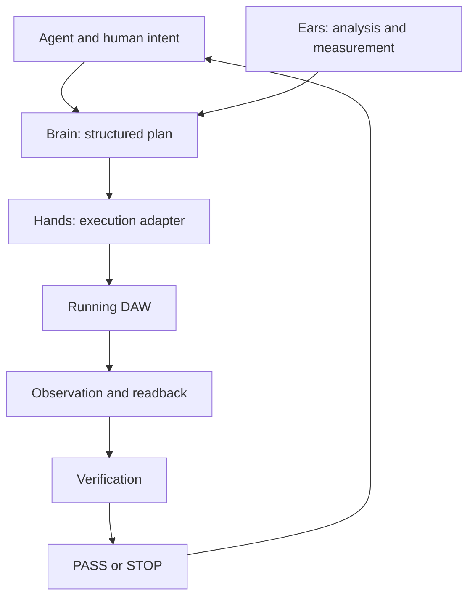

# Brain / Hands / Ears — DAWLoop Architecture

DAWLoop 将音乐意图、执行和反馈分层，让创作者与 Agent 开发者可以分别改进规划、宿主连接和分析方法。

DAWLoop separates musical intent, execution and feedback so creators and agent developers can evolve planning, host connections and analysis independently.

| 层 / Layer | 核心职责 / Responsibility | 公开模块 / Modules |
| --- | --- | --- |
| Brain — Music Planning & Agent Rules | 音乐网格、NotePlan、MusicalPlan、约束与验证 / Timing, plans, constraints and verification | dawloop.time, note_plan, music_plan, learning, verification |
| Hands — DAW Execution & Control | 目标识别、已有Pattern导航、执行适配与状态获取 / Target identity, existing-Pattern navigation, execution and observation | DAWLoop Controller, adapters, Runtime; bundled FL Studio MCP |
| Ears — Production Intelligence | SMF、编排、RMS、推子规划、SoundFont辅助 / MIDI, orchestration, RMS, fader plans and SoundFont utilities | dawloop.production |

## 工作循环 / The workflow loop

图表示职责与反馈方向。每条实际执行路径有独立能力合同；Agent 根据可用观察决定下一步，需要确认的操作保留人工审阅。

The diagram expresses responsibilities and feedback. Each execution path has its own capability contract, with human review where required.

## Desktop 与 Runtime / Desktop and Runtime

Desktop Music Intelligence 提供音频、编辑器、组件与音乐库界面；模型任务在后台 Worker 执行，经隔离 Preload 与受控 IPC 连接。公开 Desktop 源码在 [v0.5.6-alpha.1](https://github.com/ryurikoneko/DAWLoop/tree/v0.5.6-alpha.1)。Python Runtime 位于 main，用于音乐合同、Agent 集成与宿主研究。

Desktop offers audio, editors, components and library UI with background Workers, isolated Preload and controlled IPC. Its release source is separate from the Python Runtime on main.

## 音乐合同与学习

MusicalPlan组织段落、和声、声部与变化约束；Learning Protocol接受用户自己的分析器或Agent提供的特征和反馈，形成版本化profile与计划。Core提供合同与校验，实际提取方法由所接入的分析器决定。

MusicalPlan organizes sections, harmony, voices and variation constraints. The Learning Protocol accepts features and feedback from a user's analyzer or agent, producing versioned profiles and plans. Core supplies contracts and validation; the connected analyzer supplies extraction.

## 扩展与安全 / Extension and safety

新增 adapter 应明确定义目标、操作预算、执行、实际观察与 STOP 条件。分析结果用于下一份计划；可用完整读回的路径再进行事件集合比较。Runtime 已有受限 Native FAST 现场记录和离线验证器；通用计划到 FAST 的转换、新 MCP 现场路径与 Desktop 宿主接线按 [能力合同](CAPABILITIES.md) 逐项推进。

Adapters define target identity, operation budgets, execution, actual observation and STOP conditions. Analysis informs the next plan; complete readback enables event-set comparison. Existing constrained Native FAST evidence and offline validators are recorded separately from the remaining integrations.

[部署操作合同](DEPLOYMENT.md) · [验证规则](VERIFICATION.md) · [Runtime 指南](RUNTIME_GUIDE.en.md) · [原始技术架构](archive/public-presentation-20261014/docs__ARCHITECTURE.md.txt)
