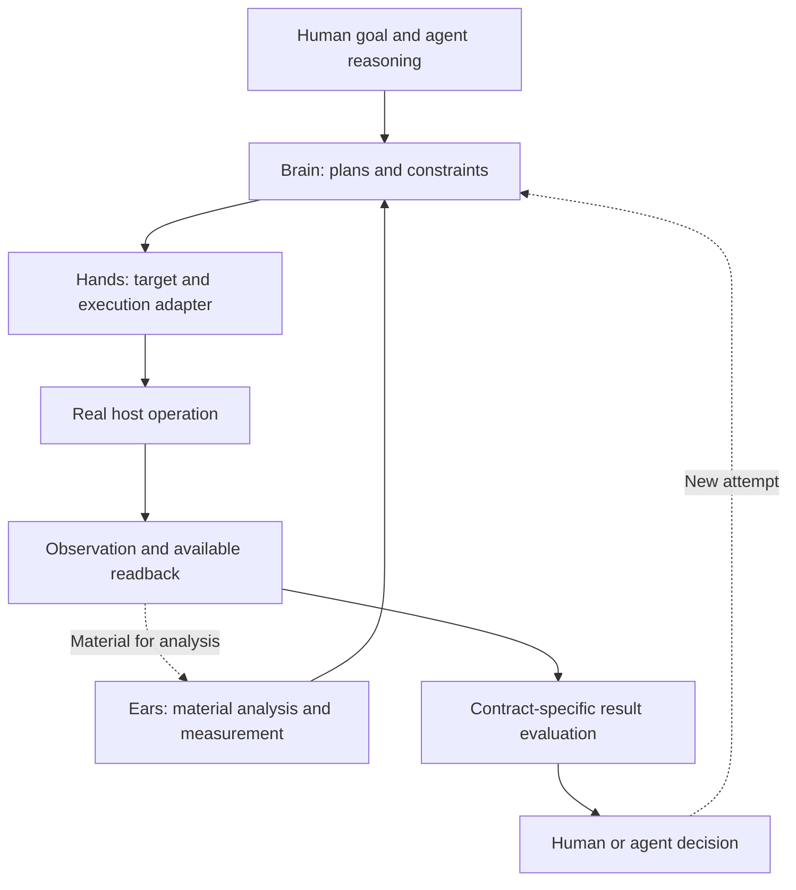
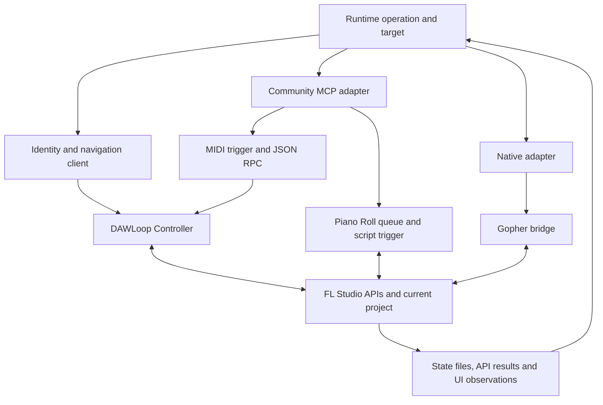

# 从音乐意图到宿主反馈 / From intent to host feedback

DAWLoop 把三个可以独立改进的部分连接起来：理解与计划音乐、在宿主中执行动作，以及从素材和操作结果中取得反馈。这样，创作者可以使用熟悉的编辑工作区，Agent 开发者也可以接入自己的规划、分析或执行方法。

DAWLoop connects three independently extensible responsibilities: musical intent and planning, host execution, and feedback from material and results. Creators get a familiar editing workspace, while agent developers can connect their own planning, analysis and execution methods.

## Brain / Hands / Ears

| 层 / Layer | 负责什么 / Responsibility | 一个实际用途 / Example |
| --- | --- | --- |
| Brain — 计划与规则 / Planning and rules | 音乐网格、Note Plan、MusicalPlan、约束校验与结果比较 / Timing, plans, constraints and comparison | 用起点、时值、音高、力度表达一个乐句 / Describe a phrase precisely |
| Hands — 执行与目标 / Execution and targets | Adapter、Controller、目标准备与宿主调用 / Adapters, Controller, target preparation and calls | 选中已有 Pattern 与 Channel，再派发获准操作 / Prepare the existing target and dispatch |
| Ears — 分析与制作辅助 / Analysis and production assistance | MIDI/编排检查、音频测量与规划输入 / MIDI/orchestration analysis and measurements | 找出密集片段，或为下一次电平调整提供参考 / Find a dense section or inform a level plan |

例如，Agent 想准备一个稀疏短句：Ears 检查素材密度，Brain 把用户选择变成有边界的计划，Hands 连接目标与执行；随后取得的状态和观察又成为下一轮判断的输入。

For a sparse phrase, Ears can inspect density, Brain can express the user's choice as a bounded plan, and Hands can connect it to a target and action. Resulting state and observations inform the next decision.

图展示职责与反馈关系。理解用户意图的模型由接入方提供；Core 校验音乐数据与操作合同。每条实际路径按自己的可观察信息形成结果。

The diagram describes responsibilities. The integrating agent supplies language understanding; Core validates musical data and operation contracts. Each real path reports results using the information it can actually observe.

## Desktop 与 Runtime 分别如何工作 / Two delivery paths

Desktop 的 Music Intelligence 提供素材、试听、分析、旋律与编辑器界面。用户通过组件管理准备分析或转录环境，再保存报告、乐谱或导出 MIDI。界面、受控应用接口与后台任务各自分工，用户围绕音乐成果操作。

Desktop provides material, listening, analysis, composition and editor views. Component Manager prepares analysis/transcription environments; users save reports or scores and export MIDI. UI, controlled application interfaces and background tasks have separate roles.

Python Runtime 提供音乐合同、Agent 接口、执行适配与验证器。调用方提供明确目标、会话与获准动作，Runtime 再组织相应后端。Desktop 本地乐谱与 Runtime 的宿主操作数据是不同入口，适配需要明确各自单位和执行合同。

Python Runtime provides music contracts, agent interfaces, adapters and validators. Callers supply explicit targets, sessions and permitted actions, and Runtime organizes the backend. Local Desktop scores and host-operation data are separate entry points with explicit unit and contract adaptation.

| 来源 / Source | 阅读入口 / Entry |
| --- | --- |
| Desktop Alpha.2 | [发行标签源码](https://github.com/ryurikoneko/DAWLoop/tree/v0.5.6-alpha.2)、[Music Intelligence](https://github.com/ryurikoneko/DAWLoop/blob/v0.5.6-alpha.2/apps/desktop/src/MusicIntelligence.tsx) |
| Runtime on main | [runtime](../src/dawloop/runtime/)、[adapters](../src/dawloop/adapters/) |
| 音乐创作者 / Creators | [Desktop 操作指南](DESKTOP.md) |
| Agent 开发者 / Developers | [Quickstart](QUICKSTART.md)、[部署合同](DEPLOYMENT.md) |

## 音乐合同与学习

NotePlan 用整数 tick 与 MIDI 音高/力度表达事件，MusicalPlan 组织段落、和声、声部和变化约束。PPQ 决定每四分音符的 tick 数，适配器必须核对时间基准，再把计划转为目标后端的输入。

NotePlan expresses events with integer ticks and MIDI pitch/velocity. MusicalPlan organizes sections, harmony, voices and variation. PPQ defines ticks per quarter note, so adapters check the timebase before translating a plan into backend input.

例如，Core 中一个音符可以明确写成起点 0、持续 96 tick、音高 60、力度 96；只有同时给出 PPQ，才能正确解释其音乐时长。Community 适配器转换为其音符格式，受限 FAST 入口则校验自己的固定计划形状和规范化力度。

For example, start 0, duration 96 ticks, pitch 60 and velocity 96 only define a musical duration together with PPQ. The Community adapter converts its note format; constrained FAST validates its own fixed plan shape and normalized velocity.

Learning Protocol 接收用户自己的分析器/Agent 提供的特征与反馈，输出版本化 profile 和计划。它把参考素材、提取结果、推断及未知项分别记录，便于审阅一个建议来自哪里。[学习指南](../learning/WORKFLOW.md)

Learning Protocol accepts features and feedback from a user's analyzer/agent, producing versioned profiles and plans. Reference material, extracted results, inference and unknowns remain separate so a suggestion can be reviewed.

## 执行后端与 Controller / Backend responsibilities

Runtime 的操作调用与目标准备并行分工。Controller 用 FL MIDI Scripting 读取身份、选择已有对象；Community 后端的普通工具调用由 MIDI/JSON RPC 驱动，Piano Roll 通过请求文件与宿主脚本触发；Native 后端通过 Gopher 页面桥接传递受审操作。

Target preparation and operation calls have distinct roles. Controller uses FL MIDI Scripting for identity and existing-object navigation. Community tools use MIDI/JSON RPC, with a separate request-file/script-trigger Piano Roll path. Native uses the Gopher page bridge for reviewed operations.

这张图强调路径差异。Controller 目标信息可以为某条执行路径提供上下文，但 Native 操作并不需要先通过 Community MCP 调用。

The diagram emphasizes path differences. Controller target information can supply context to an execution path without making Community MCP a mandatory hop for Native operations.

## 目标身份与上下文 / Establish the destination

Pattern 名称、编号和 Channel 全局索引帮助定位对象；Controller build、加载 session 和工程上下文标识帮助确认观察来自哪次运行。目标准备先读取身份，再导航、观察界面并重新读取，核对请求目标与实际界面。

Pattern number/name and global Channel index locate musical objects; Controller build, loaded session and project context identify the running observation. Target preparation reads identity, navigates, observes the UI and reads again to compare the requested destination with the actual interface.

名称与索引各有用途：同名对象仍需要索引与上下文；选中通道与当前 Piano Roll 的关系还需要观察。已有目标导航以固定动作组成，便于限制操作预算和核对前后信息。

Names and indices play different roles. Repeated names still need index/context, and the relationship between selection and the open Piano Roll needs observation. Fixed navigation steps make budgets and before/after checks explicit.

[Controller 读回](../src/dawloop/adapters/fl_controller_identity.py) · [目标准备](../src/dawloop/adapters/fl_target_preparation.py) · [导航](../src/dawloop/adapters/fl_target_navigation.py)

## 观察、读回与验证 / Three kinds of feedback

执行回执说明请求经历了什么，界面观察说明可见应用状态，结构化读回提供可比较的事件或参数。验证器只依据相应合同需要的信息判断。例如，完整音符集合使用字段与重复次数比较，而固定 FAST 场景保留人工接受、应用观察与完成回调。

Acknowledgements describe execution, UI observations describe visible application state, and structured readback supplies comparable events or parameters. A verifier evaluates the information required by its contract: full note sets use field and duplicate-count comparison, while the fixed FAST record retains human acceptance, application observation and completion callbacks.

开发者：Exact-Set 怎样比较 / How Exact-Set comparison works

比较对象为 `(start_tick, duration, pitch, velocity)` 的事件多重集合；两个相同事件需要保留两次。缺失、多余和字段差异分别报告，读回失败进入停止路径。这个算法可以离线复验；现场使用还要求目标和读回来源符合对应合同。

The comparator treats `(start_tick, duration, pitch, velocity)` events as a multiset. Two identical events count twice. Missing, extra and mismatching fields are reported separately; read failures stop the flow. The algorithm can be tested offline, while live use also requires valid target and readback provenance.

[Core verification](../src/dawloop/verification/exact_set.py) · [Community adapter](../src/dawloop/adapters/fl_studio_mcp/adapter.py) · [FAST runtime](../src/dawloop/runtime/fast_music.py)

## 人工参与与扩展 / Human review and extensions

调用方先明确任务授权，受限 Native 路径再保留宿主 Preview/Accept 的人工决定。派发后结果未知时停止后续动作，新的计划形成新的尝试记录。控制值核对与音频结果核对分别设计，后续响度成功不能改写此前控制结果。

Callers establish permission first; the constrained Native path then preserves the user's host Preview/Accept decision. Unknown post-dispatch outcomes stop further actions, and a new plan creates a new attempt. Control-state and audio-outcome verification remain separate, so later audio success does not rewrite an earlier control result.

新分析器提供可审阅的输入；新 adapter 声明目标、可执行动作、观察/读回能力与停止条件。这样可以扩展工具和宿主，同时保持计划与结果之间可检查的关系。[贡献](../CONTRIBUTING.md) · [详细消息时序](FL_STUDIO_MCP.md)

New analyzers supply reviewable inputs; adapters declare targets, supported actions, observations/readback and stop conditions. That supports new tools and hosts while keeping the relationship between plans and results inspectable.

## 当前版本说明 / Current Version Notes

- Desktop Alpha.2 与 Runtime main 是独立交付；通用 MusicalPlan 到各宿主的转换按具体适配推进。 / Desktop and Runtime are separate deliveries, with explicit per-backend plan adaptation.
- 受限 Native FAST 有固定16-note现场记录，实际终态 `COMPLETED_UNVERIFIED`；producer-side Exact-Set 状态保留。 / The constrained record retains its actual terminal and verification scope.
- Community adapter 有目标检查、写入与独立状态请求的实现；完整现场证据与适用条件见 [验证文档](VERIFICATION.md)。 / The Community implementation and its live-evidence scope are separate.
- 语言理解由接入的Agent提供；分析器、计划适配和宿主操作需要明确连接。 / The integrating agent supplies language understanding; analyzers, plan adaptation and host operations require explicit connections.
