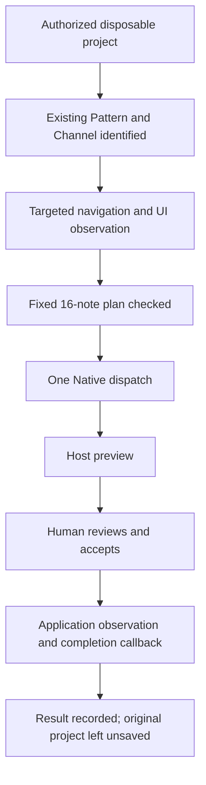

# DAWLoop 情景演示 / DAWLoop in practice

Desktop、Plugin 与 Runtime 围绕同一个问题：怎样把音乐意图变成下一步可以继续制作的内容？第一条在独立 Desktop 中完成，第二条展示真实 FL Studio 中已经记录过的受控操作。

Desktop, Plugin and Runtime address the same question: how does a musical idea become something you can work with next? One uses standalone Desktop; the other follows a recorded, controlled operation inside real FL Studio.

## 演示 A：从音乐素材到 MIDI / From material to MIDI

### 你想完成什么 / The goal

你有一段自有 WAV，想研究它的能量变化，给自己准备一段可编辑旋律。Desktop 让你在素材、分析报告与音符之间来回工作，保留试听和选择的过程。

With a WAV of your own, you want to explore its energy changes and prepare an editable melody. Desktop keeps material, reports and notes in one workspace, leaving room to listen and choose.

### 第一步：带入并听懂素材 / Bring it in and listen

导入音频，播放、暂停或定位到一个转折。假设你听到伴奏在后半段变密，可以把这个变化作为下一步分析的关注点。素材列表和试听入口让你继续回到原声参考。

Import, play, pause and seek to a transition. If the backing becomes denser in the second half, use that as a question for analysis, returning to the original audio whenever you need a reference.

### 第二步：用报告形成问题 / Turn the report into a creative decision

查看响度、能量走势、节奏变化与调性候选。例如，决定在密集部分保持短句和留白，在相对平静处延长音符。主动保存有价值的报告，以后可以重新打开。

Review levels, energy, rhythmic changes and key candidates. You might leave space in a busy passage and sustain notes in a quieter one. Save a useful report so you can revisit it.

### 第三步：创建与选择旋律 / Create and choose a candidate

把自己的判断落实到调性、和声、节奏、密度和 Seed 设置，再创建规则辅助旋律。换一个 Seed 比较另一版，或保留部分乐句继续编辑。如果任务是研究已有乐器旋律，可以改走已安装 Basic Pitch 的转录分支。

Translate your decisions into key, harmony, rhythm, density and seed settings. Compare another seed or keep a phrase for editing. When studying an existing instrumental line, use the optional transcription route with Basic Pitch installed and configured.

### 第四步：编辑、保存与带走 / Edit, save and take it further

在 Piano Roll 选择音符，移动音高、起点，调整时值和力度；试听与撤销帮助比较不同处理。给满意的乐谱命名保存，导出 MIDI 后在自己的 DAW 继续音色和编排工作。

Select notes in the Piano Roll and edit pitch, start, duration and velocity. Audition and undo help compare ideas. Save a named score and export MIDI for instruments and arrangement in your DAW.

成果：一份可重开的分析报告、一份可继续编辑的乐谱与一个 MIDI 文件。图片分别展示已有界面，不是同一素材的一次连续录屏；以上是由现有功能构成的使用场景。

**What you keep:** a saved report, an editable score and a MIDI file. The images show existing interfaces separately, not a continuous recording of this one source file; the scenario combines the available features.

## 演示 B：在真实 FL Studio 中准备并应用短句 / A phrase inside real FL Studio

### 为什么需要宿主流程 / Why work inside the host?

当任务要求操作某个已有 Pattern 中的乐器，音符本身只是意图的一部分。Runtime 还要建立“哪个片段、哪个通道、当前界面与会话是否对应”的上下文，然后组织一次可观察的动作。

For a task on an instrument in an existing Pattern, notes are only part of the intent. Runtime also establishes which segment and Channel to use, and whether the current UI and session match, before organizing an observable action.

以下故事来自 [公开 session 7 摘要](../evidence/public/fast_session_7.json)，对应受限 Native FAST 路径。它解释一次已经发生的实验，不是可直接对私人作品运行的通用脚本。

The story comes from the public session 7 summary for the constrained Native FAST path. It explains an actual experiment, rather than a general script for private production projects.

### 开始前：工程、范围与许可 / Project, scope and permission

维护者准备专用测试工程，保留原工程基线；选定已有 Pattern 1、808 Kick 和 PPQ 96，操作范围为第 5–8 小节的固定 16-note 短句。宿主写入需要明确授权，用户保留实际预览与接受操作。

The maintainer prepared a disposable project and retained its baseline. The target was existing Pattern 1, 808 Kick, PPQ 96, with a fixed 16-note phrase in bars 5–8. Host writes required explicit permission, and preview/acceptance remained with the user.

### 身份与导航 / Establish the destination

Controller 提供 Pattern 与 Channel 身份，Runtime 组织“选择已有 Pattern、独占选择通道、定向打开 Piano Roll”的导航。前后身份与界面观察用于核对可见目标，让后续动作有明确落点。

Controller supplied Pattern and Channel identity. Runtime organized selection of the existing Pattern and Channel and a targeted Piano Roll opening. Identity reads and UI observation established the visible destination for the action.

### 计划、预览与接受 / Plan, preview and acceptance

固定计划先完成输入校验和受审脚本准备，再通过 Native 桥接派发一次请求。宿主呈现预览，用户审阅并人工接受。这里要分清两次决定：派发前允许该测试范围，预览后决定是否接受实际修改。

The fixed plan passed input checks and reviewed-script preparation before one Native dispatch. The host showed a preview, and the user accepted it manually. Permission for the test scope came before dispatch; acceptance of the specific change came after preview.

图中按真实记录组织动作与信息，不用一个“成功”节点替代各阶段。 / The flow follows the recorded actions and information, rather than compressing them into a single success node.

### 实际得到的记录 / What the record contains

记录包含一次派发、零重试、零 fallback、人工回报、应用观察、宿主完成回调与用户试听确认。测试结束不保存退出，工程基线摘要核对保持，调试端口与观察任务按记录收尾。

The summary records one dispatch, no retry or fallback, a human report, application observation, completion callback and listening confirmation. The host exited without saving; the project baseline, debug port and observer teardown were checked as recorded.

原始终态为 **`COMPLETED_UNVERIFIED`**：这次执行与观察合同得到记录，完整 producer-side 音符读回与 Exact-Set 则保留为 **`NOT_VERIFIED`**。这让下一步开发能准确知道已经获得了什么证据，还需要哪一种读回。

The original terminal state is **`COMPLETED_UNVERIFIED`**. Execution and observation were recorded under that contract; complete producer-side note readback and Exact-Set remain **`NOT_VERIFIED`**. The distinction makes the next development step explicit.

[执行原理与时序](FL_STUDIO_MCP.md) · [部署合同](DEPLOYMENT.md) · [验证模型](VERIFICATION.md) · [固定公开记录](../evidence/public/fast_session_7.json)

## 演示 C：参考 MIDI 到宿主候选 / Reference MIDI to a host candidate

Composer 的真实开发界面把参考与生成内容并排展示。已有本地现场流程为：官方 MIDI 剪贴板导入 17 音 → CLI 生成 16 音 → 采样钢琴试听 → 拖入独立 FL 测试目标 → 官方 MIDI 剪贴板回读。数量、音高、起点及时值相符，力度差异对应 MIDI 7-bit 量化。

The actual Composer workspace places reference and generated material together. A local run imported 17 notes through FL's MIDI clipboard, generated 16 through the CLI, auditioned them, dragged them into a separate test target and read them back through the official clipboard. Count, pitch, start and duration matched; velocity differences reflect 7-bit MIDI quantization.

这是 Plugin 的本地场景，不改写场景 B 的 Runtime 历史结果，也不是远程 API 配置的验收。当前 r2 已作为 [Composer 预发行版](https://github.com/ryurikoneko/DAWLoop/releases/tag/plugin-v0.2.0-rc.1) 公开；产品条件见 [Plugin](PLUGINS.md)。

This local Plugin scenario does not rewrite the Runtime result in scenario B or establish acceptance of remote API configuration. The r2 build is available as the [Composer prerelease](https://github.com/ryurikoneko/DAWLoop/releases/tag/plugin-v0.2.0-rc.1); the Plugin guide explains its delivery and conditions.

## 选择自己的入口 / Choose your route

创作者从 [Desktop 指南](DESKTOP.md) 开始，先处理自己的音乐素材；开发者从 [Runtime Quickstart](QUICKSTART.md) 开始理解数据，再按 [FL 设置](FL_STUDIO_SETUP.md) 准备宿主环境。准备新的现场演示时使用合成素材和独立测试工程，在发布截图或录屏前检查隐私与权限。

Creators can start with Desktop and their own material. Developers can learn the data contracts through Quickstart before preparing host integration. New live demos need synthetic material, a disposable project, and privacy/permission review before publication.

## 当前版本说明 / Current Version Notes

- Desktop **0.5.6-alpha.2** 已公开，Basic Pitch 可在确认许可后安装；截图展示此前开发版本。 / Alpha.2 is public with licensed component installation; images show an earlier build.
- 场景 A 是独立 Desktop 使用示例；场景 B 是固定范围的历史宿主记录，两者分别交付与配置。 / The standalone example and historical host record have separate delivery and setup paths.
- 历史记录的实际终态与验证字段原样保留；本文没有新增 FL 实验或公开录屏。 / Historical states remain intact; no new host experiment or recording is claimed.
- 完整源码与功能范围见 [能力页](CAPABILITIES.md)，未来扩展见 [路线图](ROADMAP.md)。 / See Capabilities and Roadmap for implementation scope and future work.
