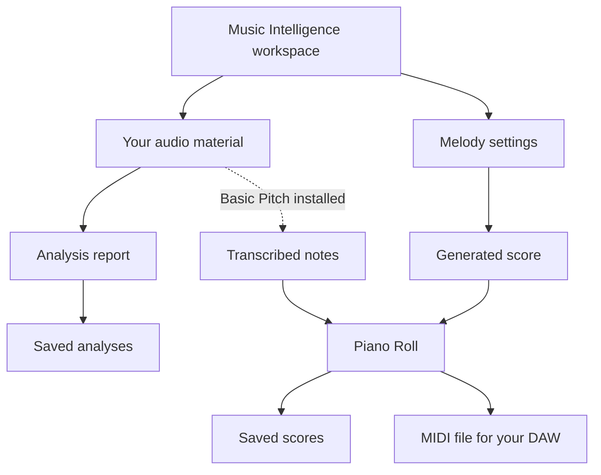

# DAWLoop Desktop 使用指南 / Desktop guide

## 欢迎来到音乐工作区 / A workspace for musical ideas

Desktop 把音乐素材、分析报告与可编辑的乐谱放在同一个 Music Intelligence 工作区。你可以从已有 WAV 寻找创作线索，也可以直接设置调性和节奏创建旋律，再用 Piano Roll 调整音符，把成果保存或导出为 MIDI。

Desktop brings musical material, analysis reports and editable scores into Music Intelligence. Explore a WAV for creative ideas or start directly with key and rhythm settings, then shape the notes in the Piano Roll and save or export your work.

本页按“带入素材 → 理解 → 创作 → 编辑 → 保存与导出”介绍独立 Desktop 体验。需要研究真实 FL Studio 操作的开发者，可在熟悉音乐数据之后进入 [Runtime 工作流](FL_STUDIO_MCP.md)。

This guide follows the standalone experience from material to analysis, creation, editing and saved output. Developers working with real FL Studio can then explore the separate Runtime workflow.

## 认识 Music Intelligence / Find your way around

主页为常用任务提供入口：试听自己的素材、查看分析、创建旋律，以及进入音频转 MIDI 与音符编辑。组件管理负责准备基础分析和可选模型；保存的分析与乐谱各有列表，方便重新打开继续研究。

The home workspace leads to listening, analysis, melody creation, transcription and note editing. Component Manager prepares basic analysis and optional models. Saved analyses and scores have their own lists so you can reopen material you want to keep working on.

图中区分输入、编辑对象和保存成果。报告可以为你选择创作方向提供参考；旋律设置与音符修改由你完成。

The diagram distinguishes inputs, editable material and saved results. Reports inform your creative direction; you choose composition settings and note edits.

## 导入与试听 / Bring in and explore audio

打开音频导入入口，选择自己有权使用的 WAV。播放时可以暂停和定位，反复听一个转折或短句，再决定需要怎样的分析。比如，先听清主奏进入的位置，再查看附近的能量与节奏变化。定位用于试听研究；分析任务的素材范围以界面中的输入为准。

Import a WAV you have permission to use. Pause and seek while listening to a transition or phrase, then choose the analysis you want. For example, locate where the lead enters and inspect nearby energy or rhythm changes. Seeking helps you study the audio; the analysis task uses the input shown in its interface.

原始音频与应用程序分开管理。选入素材以后，继续进入分析或转录任务；不用先把素材变成 MIDI 才能研究它。

Audio and program files are managed separately. After importing material, move into analysis or transcription as appropriate.

## 读懂分析报告 / Use analysis to make a decision

报告把响度、峰值、能量变化、节奏信息与调性候选组织在一起。整体响度有助于理解素材强弱，随时间的变化有助于发现进入、留白和密集段落；节奏与调性候选为创作提供参考。

The report organizes loudness, peaks, energy changes, rhythmic information and key candidates. Overall levels describe the material's intensity; changes over time help locate entrances, space and busy passages. Rhythm and key estimates provide references for composition.

例如，你想为一段由疏到密的伴奏补旋律，可以先找到能量明显变化的位置，再决定旋律在哪些地方停顿、在哪些地方增加音符。报告保留估计结果的含义，你可以结合试听选择，而不是把一个候选直接当作音乐事实。

For a backing part that grows denser, find its energy changes before choosing where your melody should pause or become more active. Combine estimates with listening rather than treating a candidate as a musical certainty.

想保留报告时使用保存操作，并从保存列表重新打开。分析的作用是帮助下一步创作：它不会替你决定最终旋律。

Save a report explicitly and reopen it from the saved list. Analysis informs the next creative step; you make the final melodic decisions.

## 创建候选旋律 / Create a melodic starting point

在旋律创作中设置速度、调性、大小调、小节数、节奏倾向和密度。和声进行帮助规则生成器选择音符；节奏倾向改变落点与运动方式；密度决定乐句的活动程度。先用较少的条件得到候选，再打开高级设置调整和声、能量曲线或 Seed。

Set tempo, key, major/minor scale, bar count, rhythmic tendency and density. Harmony helps the rule-based generator choose notes; rhythm guides placement and motion, while density changes activity. Start with a few settings, then use advanced controls for harmony, energy curve or seed.

Seed 是比较不同候选的工具：改变它探索另一种组织方式，保留它与其他设置则便于复现同一候选。这里的创作机制是规则与约束生成；自然语言创作意图字段不能被当作一个已经完成的通用语言模型作曲系统。

Use the seed to compare candidates: change it to explore a different organization, or retain it and the other settings to reproduce a candidate. This is rule-and-constraint generation. The composition-intent field is not presented as a general language-model composer.

候选出现后，试听并决定保留哪些部分，再进入 Piano Roll 修改。你不需要把第一次生成当作最终答案。

Audition the candidate, choose what you want to keep, and continue into the Piano Roll. The first candidate is a starting point for editing.

## 转录已有素材 / Transcribe instrumental material

需要从音频提取音符时，先在组件管理中阅读许可并安装 Basic Pitch，检查其状态后再提交素材。Alpha.2 提供应用内首次安装，转录组件使用应用管理的环境，不要求你另外安装系统 Python。

For audio-to-note transcription, read the terms and install Basic Pitch in Component Manager, then check its state before submitting audio. Alpha.2 supports first installation inside the application using an app-managed environment, without system Python.

选择合适的乐器素材进行转录，把得到的音符送进编辑器，结合试听调整不理想的音高、重叠或时值。这样，转录给你可修改的草稿，而音乐判断仍在你的手中。

Transcribe suitable instrument material, bring the notes into the editor, and use listening to adjust pitches, overlaps or durations that need attention. Transcription supplies an editable draft for your musical review.

## 在 Piano Roll 中塑造结果 / Shape the score

Piano Roll 用横向位置和长度表达时间，用纵向位置表达音高。你可以选择单个或多个音符，移动起点与音高，拉长或缩短音符，也可以通过属性输入精确调整起点、时值和力度。力度编辑帮助你组织重音；撤销与重做让比较不同修改更方便。

The Piano Roll places time horizontally and pitch vertically. Select one or several notes, move their start or pitch, resize them, or use numeric properties for precise timing, duration and velocity. Velocity edits shape accents; undo and redo help you compare revisions.

例如，先把乐句最后一个音拉长，再试听它与下一句之间的空间；如果不合适就撤销，改为降低力度。试听后可以继续选音、调整节奏或更换候选版本，逐步形成自己的短句。

For example, lengthen the final note and listen to the space before the next phrase. Undo it if it feels wrong and try a softer accent instead. Continue selecting, editing or comparing candidate versions until the phrase fits your intention.

## 保存、恢复与 MIDI 导出 / Keep and reuse your work

给乐谱命名并主动保存，之后从已保存乐谱列表重新打开。分析报告也有自己的保存操作和列表。关闭应用前先保存需要保留的成果；重启后从列表恢复它们，继续试听或编辑。

Name and explicitly save a score, then reopen it from the saved-score list. Analysis reports have separate save actions and lists. Save what you want to keep before closing the application and reopen it after restart to continue listening or editing.

导出 MIDI 可以把音符带到自己的 DAW，继续选音色、编排与制作。MIDI 携带音符与时间信息；最终声音取决于接收工程中的乐器与制作设置。

Export MIDI to bring the notes into your DAW for instrument selection, arrangement and production. MIDI carries note and timing data; the receiving instruments and project settings determine the sound.

## 组件与工作区管理 / Manage components and workspace results

组件页显示可用状态、安装条件和许可确认入口。先准备基础组件，再按任务选择转录模型；Basic Pitch 下载约 136.5 MiB，安装前至少留出 1 GiB 可用空间。安装过程中保留许可与错误提示，根据实际状态检查或重试。

Component Manager shows availability, installation requirements and license confirmation. Prepare basic components first, then choose transcription models for your task. The Basic Pitch archive is about 136.5 MiB; allow at least 1 GiB of free space before installation. Follow displayed states and errors when checking or retrying setup.

界面支持中英文。普通用户可以围绕素材、报告和乐谱组织工作；开发者需要更详细环境信息时再使用相应诊断入口。升级前备份用户数据，保留已有模型环境和保存成果。

The UI supports Chinese and English. Everyday work is organized around material, reports and scores; developers can use diagnostics when they need environment details. Back up user data before upgrades and preserve existing model environments and saved results.

## 完整场景：从 WAV 获得创作线索 / A complete example

你有一段自己制作的 WAV，希望为它准备一个新的旋律想法：

1. 导入并试听，定位伴奏开始变密的地方。
2. 查看分析报告，记录值得参考的能量变化和调性候选。
3. 自己选择调性、和声、较低密度和节奏条件，生成一段规则辅助旋律。
4. 在 Piano Roll 缩短几个音符、调整乐句结尾与力度，并试听变化。
5. 命名并保存乐谱，导出 MIDI，带回自己的制作工程继续处理音色与编排。

With a WAV of your own, listen for a denser entrance, use the report to inform your key and energy choices, set composition constraints, and generate a candidate. Edit phrase endings, lengths and accents in the Piano Roll, then save a named score and export MIDI for further production. The result is a reusable analysis report, an editable score and a MIDI file.

[带图的双场景演示](DEMOS.md) · [功能与实现](CAPABILITIES.md) · [Runtime 与 FL Studio](FL_STUDIO_MCP.md)

## 下载与首次启动 / Download and first launch

[Windows x64 Portable ZIP](https://github.com/ryurikoneko/DAWLoop/releases/download/v0.5.6-alpha.2/DAWLoop%2B0.5.6-alpha.2-Windows-x64-Portable.zip) · [Release 与 SHA256SUMS.txt](https://github.com/ryurikoneko/DAWLoop/releases/tag/v0.5.6-alpha.2)

运行前核对官方来源与校验和；程序未签名，保留 Windows 安全保护。先备份升级前的数据；组件安装前阅读对应许可。

Before running the unsigned application, verify its official source and checksums and keep Windows security protections enabled. Back up existing data before upgrades and read component terms before installation.

解压完整目录 → 运行 `DAWLoop.exe` → 安装基础组件 → 导入 WAV；需要转录时再安装 Basic Pitch。无需系统 Python、Node 或 Codex。

Extract the complete directory → run `DAWLoop.exe` → install basic components → import WAV. Install Basic Pitch when you need transcription. System Python, Node and Codex are unnecessary.

## 当前版本说明 / Current Version Notes

- 本页对应公开 Windows x64 Desktop **0.5.6-alpha.2**；独立干净 Windows 兼容性待确认。 / This is the public Windows x64 Alpha; independent clean-Windows compatibility awaits confirmation.
- 基础分析使用 WAV；节奏与调性候选是估计。Basic Pitch 用于乐器素材，转录质量需要审阅。 / Basic analysis uses WAV; rhythm/key estimates and instrument transcriptions need review.
- 截图来自此前开发版本，展示相应工作区与编辑界面。 / Screenshots illustrate the workspace and editors from an earlier build.
- Desktop 本地编辑与 Runtime 真实 FL 集成分别交付和配置。 / Local editing and Runtime host integration have separate delivery/setup paths.
- [Desktop 发行源码](https://github.com/ryurikoneko/DAWLoop/tree/v0.5.6-alpha.2)、[来源与组件许可](../THIRD_PARTY_NOTICES.md)、[后续方向](ROADMAP.md)。 / Use these references for source, component terms and future work.
