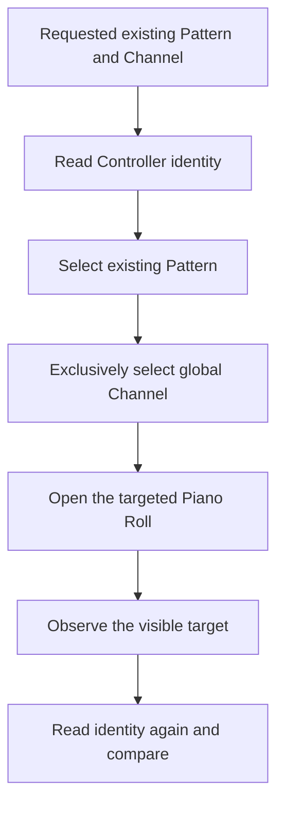
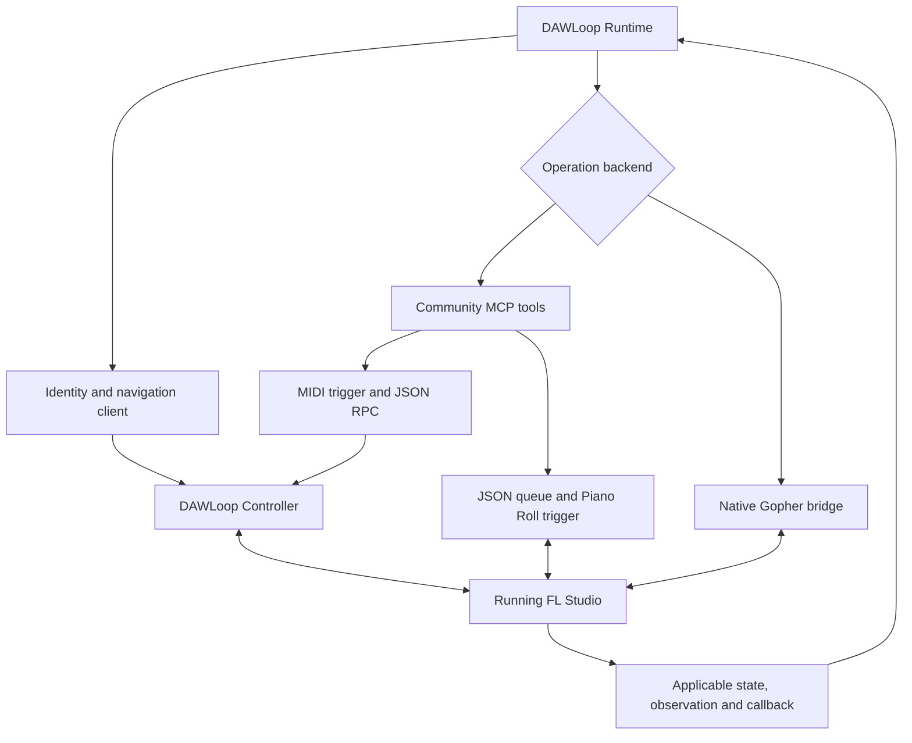
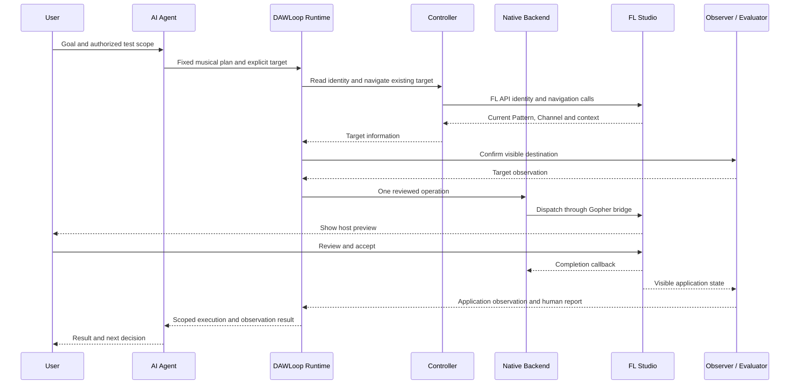

# 在真实 FL Studio 中执行与观察 / Acting and observing inside FL Studio

当 Agent 的任务指向某个乐器声部，仅有音符数据还不够描述整次工作。它还需要知道：目标是哪一个 Pattern 和 Channel，动作怎样进入宿主，执行以后又能取得哪些状态。DAWLoop 把音乐计划、目标准备、后端调用与结果核对组织在一起。

When an agent works on an instrument part, note data is only part of the task. It also needs the Pattern and Channel, a path into the host, and information about the resulting state. DAWLoop organizes musical plans, target preparation, backend calls and result evaluation together.

## 从一个请求开始 / Start with a musical request

例如，用户希望为已有 Pattern 中的某个乐器准备短句。Agent 可以先把意图写成明确的音符位置、长度、音高与力度，并附上目标和允许范围。Runtime 校验这些数据，再按实际后端的合同组织操作。

For a phrase in an existing Pattern, the agent can describe note positions, lengths, pitches and velocities, with an explicit destination and permission scope. Runtime validates the data and organizes the operation under the backend's actual contract.

| 部分 / Layer | 解决的问题 / What it answers |
| --- | --- |
| 音乐计划 / Musical plan | 想出现什么音符和节奏？ / Which notes and timing are intended? |
| 目标管理 / Target management | 修改哪个片段、乐器和会话？ / Which segment, instrument and session? |
| 执行工具 / Execution tools | 怎样调用宿主的受支持操作？ / How is the supported host operation invoked? |
| 观察与核验 / Observation and evaluation | 实际发生什么，足以得出什么结论？ / What happened, and what can the evidence establish? |

以一个固定短句为例：计划定义时间和音符；Controller 识别目标；后端发送一次受控请求；观察者取得对应应用状态，报告再说明哪些条件得到满足。四层围绕同一个操作工作，而非四份彼此无关的模块清单。

For a fixed phrase, the plan defines notes and timing, Controller identifies the destination, a backend sends a controlled request, and the observer supplies application information for the report. The layers work on one operation together.

## MCP 与执行后端 / MCP and execution tools

MCP（Model Context Protocol）让工具客户端以结构化名称与参数调用工具，并取得响应。Community FL Studio MCP 将一组 FL 操作开放成工具，Agent 因而可以访问 transport、Channel、Mixer、Piano Roll 和已加载插件参数等领域。

MCP lets tool clients invoke named tools with structured arguments and responses. Community FL Studio MCP exposes FL operations across transport, Channels, Mixer, Piano Roll and loaded-plugin parameters.

DAWLoop 固定捆绑 [karl-andres/fl-studio-mcp](https://github.com/karl-andres/fl-studio-mcp) 的源码快照，适配层负责将项目计划和结果接入这些工具。源码位于 `third_party/fl-studio-mcp/`，DAWLoop 自有代码位于 `src/dawloop/adapters/`，上游版权与 MIT 原文保留。

DAWLoop bundles a pinned upstream snapshot and adapts project plans and results around it. Upstream source remains under third_party, project adapters under src, with original copyright and MIT text intact.

DAWLoop也提供自己的 [MCP stdio工具服务](../src/dawloop/fast_mcp_server.py)，用于向Agent暴露FAST任务、状态与人工报告。协议同为MCP，服务角色却不同：该入口可以接Native路径，不意味着操作经过Community后端。

DAWLoop also provides its own MCP stdio tool server for FAST tasks, status and human reports. Sharing the protocol does not make it the same backend: that entry point can serve the Native path without passing through Community FL Studio MCP.

## 为什么要读 Pattern 和 Channel / Know the musical destination

Pattern 是当前编辑的音乐片段；Channel 指向该片段中的乐器。请求里应同时表达编号/索引与预期名称，并核对工程上下文。Controller 还能提供 PPQ，让整数 tick 具有明确音乐含义。

A Pattern is the musical segment being edited; a Channel identifies the instrument. Requests carry both indices and expected names, checked against project context. Controller also supplies PPQ so integer ticks have a musical meaning.

DAWLoop Controller 通过 FL MIDI Scripting 获取 Pattern 编号和名称、Channel 全局索引和名称、当前选择、PPQ、工程标题与加载上下文。工程标题用于描述，不被伪装为永久工程 GUID。加载 build/session 与工程上下文帮助排除陈旧观察。

DAWLoop Controller uses FL MIDI Scripting to obtain Pattern number/name, global Channel index/name, selection, PPQ, project title and loaded context. The title is descriptive, not a persistent project GUID. Build/session and project context help reject stale observations.

这里是已有对象的识别与导航。目标准备把前后身份读取和独立界面观察关联起来，避免只依赖某一个选中状态。

This is identification and navigation of existing objects. Target preparation associates before/after identity reads with separate UI observation rather than relying on a single selection flag.

## 实际通信路径 / The actual communication paths

### Controller 身份与普通 RPC / Identity and ordinary RPC

Python 客户端在活动 Settings 下写入带新请求标识的 JSON 命令，用命名虚拟 MIDI input 发送触发消息。Controller 在 FL 内调用相应 API，写入 JSON 响应；Python 核对请求、build、session 和工程上下文后使用结果。返回值不是从虚拟 MIDI output 中携带回来的。

The Python client writes a JSON command with a new request identifier in the active Settings location and sends a trigger to the named virtual MIDI input. Controller calls FL APIs and writes a JSON response. Python checks request, build, session and project context before using it. The reverse virtual MIDI port does not carry that response payload.

### Community Piano Roll / Request queue and host script

上游 Piano Roll 工具把音符请求放入队列，宿主脚本在触发后应用请求并写出状态文件。适配器先核对目标与时间基准，取得初始状态，再排队写入请求；后续单独触发状态刷新、读取实际事件并转换为 Core NoteEvent。

The upstream Piano Roll tools queue note requests. A triggered host script applies them and exports a state file. The adapter checks target/timebase and initial state, queues the request, then performs a separate refresh/read and converts events into Core NoteEvents.

当前实现会检查请求队列、目标空白和状态文件更新时间。对现场结果的判断还要看完整目标与读回合同；文件更新时间只是流程中的一项观察。

The implementation checks the queue, blank target and state-file update. Live evaluation still depends on the complete target/readback contract; file modification time is one observation in that process.

### Native Gopher / A separate bridge

Native adapter 通过本机调试端点识别 Gopher 页面、建立桥接，再派发受审操作。Controller 的身份/导航用于准备目标，Native 操作本身通过桥接进入宿主。宿主 Preview/Accept、应用观察和完成回调各自保留。

The Native adapter identifies the Gopher page through a local debugging endpoint, establishes a bridge and dispatches reviewed operations. Controller identity/navigation prepares the target; the operation itself uses the Native bridge. Host preview/acceptance, application observation and completion callbacks remain separate.

图中的分支来自不同执行实现，Controller 与 Community MCP 不是所有操作必经的串行组合。

The branches represent separate implementations. Controller and Community MCP are not a mandatory serial chain for every operation.

## 一次受限 Native 操作的信息流 / A constrained Native message sequence

开始宿主操作之前，调用方必须获准使用专用测试工程、确认目标和预算，并备份需要保护的数据。图中的第一条用户消息代表任务与授权；宿主预览后的 Accept 是另一次人工决定。

Before host operations, obtain permission for a disposable project, confirm targets/budgets, and back up protected data. The first user message establishes scope and permission; Accept after the host preview is a second human decision.

时序图解释固定现场记录中各角色如何配合；为便于阅读，省略了内部重复检查。实际 session 7 的结果保留为 `COMPLETED_UNVERIFIED`，完整音符读回/Exact-Set 状态保留在原记录中。

The sequence explains responsibilities in the fixed live record, omitting repeated internal checks for readability. Session 7 retains its actual `COMPLETED_UNVERIFIED` outcome and original event-readback/Exact-Set fields.

## 从回执到音乐结果 / From an acknowledgement to a musical result

如果计划要求四个音符出现在指定位置，“工具收到请求”还没有告诉我们它们是否按该计划存在。具备适当读回信息时，Core 比较实际与计划的事件集合，并报告缺失、多余、字段差异和重复次数。

If a plan asks for four notes at specific positions, request acceptance has not yet answered whether those notes exist as planned. With appropriate readback, Core compares the event sets and reports missing, extra and mismatched fields and duplicate counts.

**PASS** 是对应验证规则有足够数据并满足条件；**STOP** 是差异或缺失信息使该规则下的流程停止。受限观察合同另报告执行、人工接受、应用观察与完成状态，让 Agent 以其实际证据范围判断下一步。

**PASS** means sufficient data satisfies the relevant rules. **STOP** means a mismatch or missing information stops that verified flow. Scoped observation contracts separately report execution, human acceptance, application and completion so the agent can reason within that evidence.

开发者：时间与事件转换 / Timing and event conversion

Core NotePlan 使用整数 tick、MIDI pitch 与 MIDI velocity。Community 转换检查 PPQ，将上游 `time_ticks`、`length_ticks`、`midi`、规范化 velocity 转回事件；Native FAST 当前有自己的固定 PPQ 与计划结构。两个输入合同应分别校验，不靠 UI 音名或默认 PPQ 猜测。

Core uses integer ticks and MIDI pitch/velocity. The Community mapping checks PPQ and converts `time_ticks`, `length_ticks`, `midi` and normalized velocity to events. Native FAST has its own fixed PPQ and plan shape. Validate each contract explicitly rather than guessing from UI note names or a default timebase.

[格式转换源码](../src/dawloop/adapters/fl_studio_mcp/mapping.py) · [比较器](../src/dawloop/verification/exact_set.py)

## 安装与开发入口 / Set up and explore

先运行离线 [Quickstart](QUICKSTART.md) 熟悉计划，再按 [FL Studio 设置](FL_STUDIO_SETUP.md) 安装可选依赖和 Controller。`setup-fl --dry-run` 预览环境，`doctor --probe-fl` 读取本地 Controller 运行状态；后者不发送 MIDI 或身份请求。

Start with Quickstart to understand plans, then follow FL Studio setup for optional dependencies and Controller installation. The setup dry run previews the environment; doctor --probe-fl reads local Controller runtime status without sending MIDI or an identity request.

| 实现 / Implementation | 源码 / Source |
| --- | --- |
| 固定 Community 快照 / Pinned upstream | [bundled README](../third_party/fl-studio-mcp/README.md)、[Piano Roll tools](../third_party/fl-studio-mcp/src/fl_studio_mcp/tools/piano_roll.py) |
| 自有 Controller / Project Controller | [device script](../src/dawloop/fl_scripts/device_DAWLoopController.py)、[identity client](../src/dawloop/adapters/fl_controller_identity.py) |
| 目标准备与导航 / Target preparation | [preparer](../src/dawloop/adapters/fl_target_preparation.py)、[navigator](../src/dawloop/adapters/fl_target_navigation.py) |
| Community adapter | [adapter.py](../src/dawloop/adapters/fl_studio_mcp/adapter.py) |
| Native 与 FAST / Native and FAST | [transport](../src/dawloop/adapters/gopher_native/transport.py)、[write backend](../src/dawloop/adapters/gopher_native/write_backend.py)、[runtime](../src/dawloop/runtime/fast_music.py) |
| 现场范围 / Live scope | [session 7](../evidence/public/fast_session_7.json)、[verification](VERIFICATION.md)、[deployment](DEPLOYMENT.md) |

## 当前版本说明 / Current Version Notes

- 上游固定为 `f89f66f8ca00d1f1fc27ed18ae4a9611551f98d0`；上游工具能力和 DAWLoop 现场记录分别说明。 / Backend availability and project live records are distinct.
- Native 现场案例为固定16-note测试与人工接受，终态和 Exact-Set 范围按原始记录保留。 / The Native case retains its fixed scope and actual result.
- Community 现场认证、新 MCP 现场入口、通用计划转换的具体条件见 [能力与验证](CAPABILITIES.md)。 / Integration conditions are recorded in Capabilities and Verification.
- Pattern创建与新插件加载需要各自实现；已有目标导航与已加载插件参数访问分别使用对应接口。 / Pattern creation and loading new plugins require their own implementations; existing-target navigation and loaded-plugin parameters use their respective interfaces.
