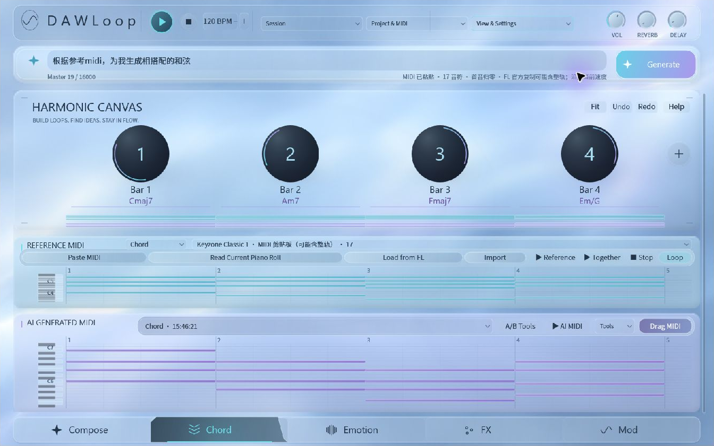

# DAWLoop Plugin — Composer

[中文](#中文) · [English](#english)

## 中文

Plugin 是 DAWLoop 的闭源宿主产品线，与开源 Desktop 和 Runtime 分别交付。[首页](../README.md)直接展示 Composer 的界面和工作流。

### Composer

参考 MIDI → 音乐目标 → 用户配置的 Agent / 模型 → 候选比较 → 采样钢琴试听 → MIDI 导出或拖入宿主。

当前本地 Windows x64 VST3 候选为 **0.2.0-rc.1 / release-experience-20261023-r2**。包含完整 Composer Bundle、冻结 worker、字体、钢琴资源、指南和第三方通知；普通用户不需另装 Python。外部前置条件为 Microsoft Visual C++ V14 x64 Runtime。现已作为 [Composer 预发行版](https://github.com/ryurikoneko/DAWLoop/releases/tag/plugin-v0.2.0-rc.1) 公开。

| 工作流 | 当前范围 |
| --- | --- |
| 参考输入 | 标准 MIDI 文件、FL 官方 Copy to MIDI clipboard 后粘贴；普通 Ctrl+C 不是受支持的 MIDI 路径，官方剪贴板可能包含整个当前通道而非选区 |
| 生成、比较与试听 | 目标/情绪/提示词、参考与生成音符对照、A/B、历史、和弦与音区设置、采样钢琴试听 |
| AI 配置 | 服务商、地址、模型、凭据库；可配置自己的 API，或由自己的 Agent 连接插件使用 |
| 宿主输出 | MIDI 导出/拖出；FL 的导入确认由用户接受 |
| 当前 Piano Roll 读取 | 可选官方 Piano Roll 辅助脚本的实时快照，无需保存工程；仍需确认实际窗口目标 |
| 名称浏览 | 兼容 Controller 提供上下文；不代替音符快照 |
| 保存工程 Pattern 读取 | 外置 reader 未分发，PyFLP / GPL 适配器不在本包；不是默认可用功能 |

#### AI Generation & Personalization

**Your agent. Your musical direction.** 用户的 Agent / 模型、外部训练或微调选择、提示词、参考素材和配置影响生成结果。插件不训练或微调模型，也不要求用户训练。主动测试/生成会将提示词、参考音符及相关参数发送给用户选定的服务商，可能产生费用。离线 MIDI 输入、试听与导出不需要 API Key。

本地现场记录覆盖官方剪贴板导入 17 音、CLI 生成 16 音、试听、拖入独立测试目标及官方 MIDI 剪贴板回读；数量、音高、起点、长度一致，力度存在标准 MIDI 7-bit 量化差异。此记录属于 Plugin 的特定测试，不替代 Runtime 历史记录，也不证明任意工程或任意远程模型可用。

### 安装与更新准备

手动安装应在关闭全部宿主后复制完整 VST3 Bundle 到标准 VST3 目录，再让宿主扫描。升级前保留旧 Bundle 与用户数据，整包替换；不能热换运行中的模块。r2 不包含独立安装器、旧更新器或已配置的生产在线更新源，不能沿用 build102 的安装器描述。

### 许可与来源

Plugin 自有私有实现闭源，允许免费安装，用于个人与商业音乐创作；不授予源码及专有二进制再分发权。见 [二进制使用条款](https://github.com/ryurikoneko/DAWLoop/releases/download/plugin-v0.2.0-rc.1/DAWLoop-Composer-Binary-Use-Terms-0.2.0-rc.1.txt)。开源 Desktop、Runtime 和本仓库既有代码仍保留 MIT 及原授权；Plugin 中开源 SDK、worker 依赖、字体与 VCSL 采样保留各自许可通知。没有把全部产品、截图或第三方组件统一改为 MIT。参见 [许可范围](../LICENSE_POLICY.md)、[媒体来源](media/README.md)。

## English

Plugin is DAWLoop's proprietary host product line, delivered separately from open-source Desktop and Runtime. The [homepage](../README.en.md) shows the interface and workflow directly.

### Composer

Reference MIDI → musical goal → your configured agent/model → candidate comparison → sampled-piano audition → MIDI export or drag into the host.

The local Windows x64 VST3 candidate is **0.2.0-rc.1 / release-experience-20261023-r2**. It includes the full Composer bundle, frozen worker, fonts, piano resources, guides and third-party notices. No separate Python installation is required; Microsoft Visual C++ V14 x64 Runtime is an external prerequisite. It is available as the [Composer prerelease](https://github.com/ryurikoneko/DAWLoop/releases/tag/plugin-v0.2.0-rc.1).

| Workflow | Current scope |
| --- | --- |
| Reference input | Standard MIDI files and FL's official Copy to MIDI clipboard command; ordinary Ctrl+C is not supported, and the official clipboard may include the whole current channel rather than a selection |
| Generation and review | Target/emotion/prompt controls, reference/generated note views, A/B, history, chord/register settings and sampled-piano audition |
| AI configuration | Provider, address, model and credential storage; configure your API or connect your own agent to the plugin |
| Host output | MIDI export/drag; the user accepts any FL import confirmation |
| Current Piano Roll read | Optional official Piano Roll helper snapshot without saving; the actual window target still needs checking |
| Source-name browsing | Compatible Controller context, separate from note snapshots |
| Saved-project Pattern read | External reader not distributed; PyFLP/GPL adapter not bundled and not an available default feature |

#### AI Generation & Personalization

**Your agent. Your musical direction.** Your agent/model, externally chosen training or fine-tuning, prompts, references and configuration shape results. The plugin does not train or fine-tune models and does not require training. Explicit testing/generation sends prompts, reference notes and relevant parameters to your provider and may incur charges. Offline MIDI input, audition and export require no API key.

Local host records cover importing 17 notes through the official clipboard, generating 16 notes through the CLI, auditioning, dragging into a separate test target and reading back through the official MIDI clipboard. Counts, pitch, start and duration matched, with standard 7-bit MIDI velocity quantization. This is a scoped Plugin test, separate from Runtime's historical records, rather than proof for arbitrary projects or remote models.

### Installation and update preparation

For manual installation, copy the complete VST3 bundle into the standard VST3 directory with all hosts closed, then rescan. Keep the old bundle and user data before replacing the full bundle; never replace a loaded module. The r2 ZIP contains no standalone installer, old updater or configured production online-update source. The build102 installer description does not apply to r2.

### Licensing and provenance

Private Plugin implementation is proprietary, with [free-use binary terms](https://github.com/ryurikoneko/DAWLoop/releases/download/plugin-v0.2.0-rc.1/DAWLoop-Composer-Binary-Use-Terms-0.2.0-rc.1.txt) allowing personal and commercial music creation, without a source-code license or redistribution permission for proprietary binaries. Desktop, Runtime and existing repository code retain MIT and their prior grants. Bundled open-source SDKs, worker dependencies, fonts and VCSL samples retain their own notices. Products, screenshots and third-party components have not been collectively relicensed as MIT. See [license scope](../LICENSE_POLICY.md) and [media sources](media/README.md).
