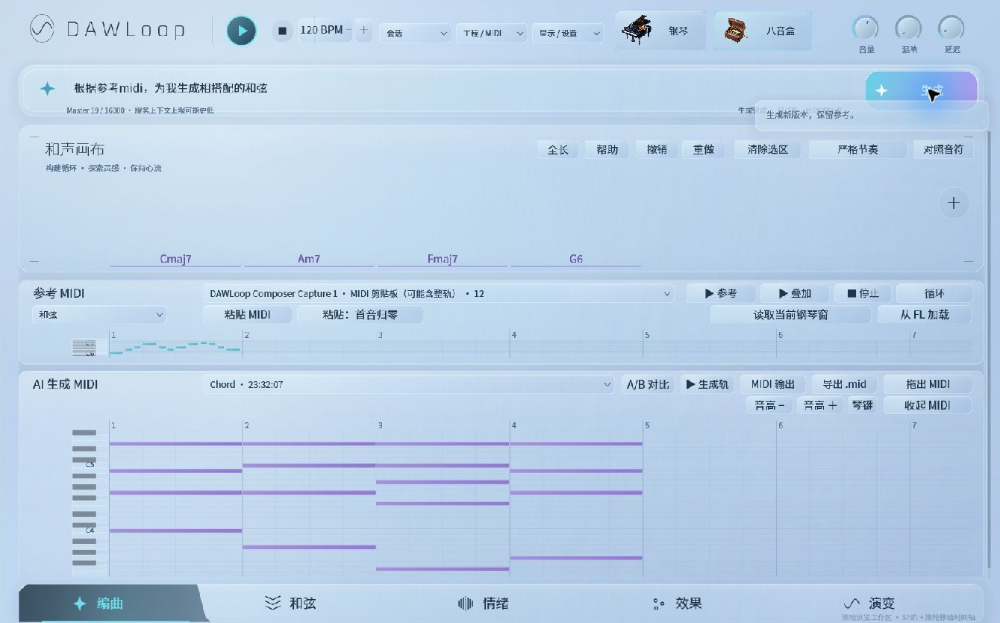
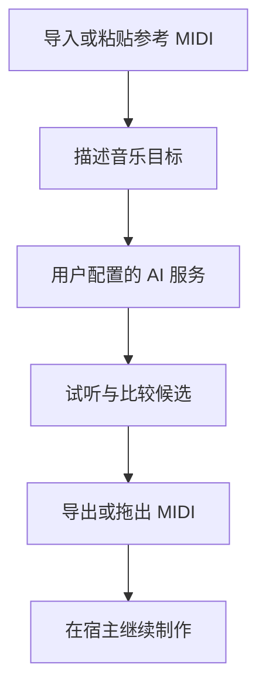
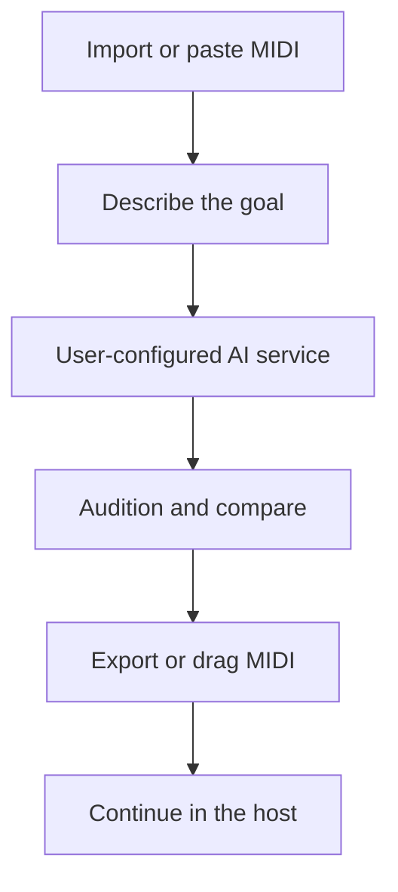

# DAWLoop Plugin — Proprietary / 闭源插件

[中文](#中文) · [English](#english)

## 中文

DAWLoop Plugin 将制作辅助放在宿主内，包含 Composer 和 Mixer 两个子产品。它与开源 Desktop、Runtime 分开开发和交付。此页展示开发候选，尚无获准公开的 Plugin 安装包或下载入口。

### Composer：参考旋律到和声候选

截图取自 build102 本机安装候选，只裁切了宿主周边界面。

导入或粘贴参考 MIDI，描述希望生成的内容，调用用户自己的 AI 服务生成候选，再用内置 Piano / Music Box 试听、比较并导出或拖出 MIDI。已有本机记录覆盖实际生成、17 音符拖入宿主、官方 MIDI 剪贴板读回和粘贴回 Reference。它不是任意工程的自动作曲或自动写回承诺。

无需保存工程的 Piano Roll 快照读取已有开发测试记录；正式入口仍在核对目标身份及编辑后的刷新行为。保存工程的旧 Pattern 读取依赖未随便携候选分发，不能视为可用基础功能。

### Mixer：音频测量方向

Mixer 有独立插件身份和音频直通、峰值与 RMS 测量实现。它仍是开发模块，尚未作为本轮 Composer 安装候选的一部分完成发行验收。此处不提供 Mixer 下载，也不宣称自动平衡、推子闭环或自动混音已完成。

### 安装、更新与许可

Plugin 的目标平台是 Windows x64 / VST3。当前本机候选支持标准目录安装和本地测试源的更新、恢复流程；公开发行者签名、正式更新信任根及在线升级验收仍需完成。不会把 Runtime wheel 当成插件安装包。

Plugin 自有实现保持闭源；最终二进制使用条款将在获批发行时提供。Desktop、Runtime 及本仓库既有开源代码保留原许可。插件使用的开源组件保留各自版权和许可证通知；本仓库根 MIT 不应被理解为授予尚未公开的 Plugin 私有实现。

## English

DAWLoop Plugin brings production assistance into the host through two subproducts: Composer and Mixer. It is developed and delivered separately from the open-source Desktop and Runtime. This page previews development builds; no Plugin installer or public download has been approved.

### Composer: reference notes to harmony candidates

This image comes from a locally installed build102 candidate. Only the surrounding host interface was cropped.

Import or paste reference MIDI, describe the musical goal, generate a candidate using your own configured AI service, audition it with the built-in Piano or Music Box, then export or drag out MIDI. Local records cover real generation, a 17-note drag into the host, readback through the official MIDI clipboard and import back into Reference. These results do not establish arbitrary-project autonomous composition or automatic writeback.

Development tests have read Piano Roll snapshots without saving the project. Target identity and refresh behavior after edits are still being checked for the formal entry point. Dependencies for the older saved-Pattern import are not included in the portable candidate, so that route is not an available baseline feature.

### Mixer: audio measurement in development

Mixer has its own plugin identity and implements audio passthrough, peak and RMS measurement. It remains a development module and has not completed release acceptance as part of the Composer installer candidate. There is no Mixer download here, nor a claim of verified fader control, automatic balancing or automatic mixing.

### Installation, updates and licensing

Plugin targets Windows x64 / VST3. The local candidate supports standard-directory installation and update/recovery against a local test source. Publisher signing, a production update trust root and online upgrade acceptance remain outstanding. A Runtime wheel is not a plugin installer.

Project-authored Plugin implementation remains proprietary; approved binary releases will include their applicable terms. Desktop, Runtime and existing open-source repository code retain their licenses. Bundled open-source components retain their own notices. The repository's root MIT License does not grant rights to unpublished private Plugin implementation.
