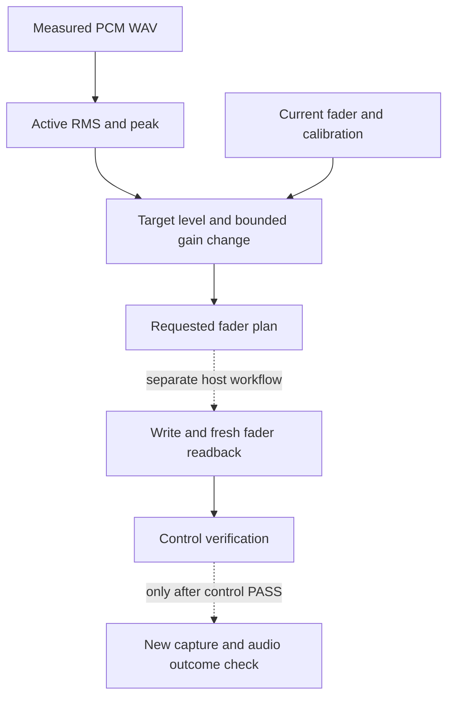

# Production Pipeline — 让分析成为下一步制作的依据

一份MIDI哪里最密集？一个乐句适合哪种音域的乐器？音频中的长静音是否掩盖了实际演奏部分的电平？DAWLoop Production Pipeline 为这些制作问题提供结构化分析，让人和Agent可以据此选择下一步计划。

Where is a MIDI part densest? Which instrument register suits a phrase? Is a long silence hiding the level of the actual performance? DAWLoop Production Pipeline provides structured analysis for these production questions, helping people and agents choose their next plan.

[运行示例](QUICKSTART.md) · [功能目录](CAPABILITIES.md) · [架构](ARCHITECTURE.md)

## 先找值得研究的MIDI片段 / Find a useful MIDI section

当一个文件包含多个轨道时，先查看轨道名、时间基准和note-on事件，可以定位需要研究的乐器。密集窗口分析按指定拍数与窗口小节数统计音符起点，建议最密集的连续窗口；这适合选择配器检查或后续音频测量的片段。

For a multi-track file, track names, timing division and note-on events help locate a part. Dense-window analysis counts note starts over a chosen meter and window length, suggesting a dense consecutive bar range for orchestration inspection or subsequent audio measurement.

例如，先找钢琴轨道中最密集的三小节，再检查这些小节的音区。这里的“密集”指音符起点数量，不是和声质量、演奏难度或音频响度。SMF读取器返回事件起点、音高和力度，适用于这类结构检查。

For example, find the densest three bars of a piano track, then inspect their register. Density means note-on count, rather than harmonic quality, playing difficulty or audio loudness. The SMF reader exposes note starts, pitches and velocities for this structural inspection.

## 从乐句到配器检查 / From a phrase to orchestration checks

配器辅助比较乐句音高与候选乐器的可演奏、优选音域，帮助选择较合适的承接乐器。音区空缺检查按时间采样，指出某个音高带没有发声事件的窗口；源音符覆盖则比较改编前后的起点和音高，并保留重复次数，必要时明确启用八度等价。

Instrument selection compares phrase pitches with playable and preferred ranges. Register-gap checks sample sounding notes to locate windows with no activity in a chosen pitch band. Source coverage compares onsets and pitches before and after arrangement, preserving multiplicity and optionally treating octaves as equivalent.

这些结果能回答“旋律是否被分给过低的乐器”“这一段中音区是否空了”“改编是否漏掉了原本想保留的音符”。是否补齐空区、是否保留每个源音符，仍由创作目标决定。

These checks help ask whether a phrase sits too low for its instrument, whether the middle register is empty, or whether an arrangement omitted notes intended for preservation. The creative goal determines whether a gap should be filled or every source note retained.

## 测量实际演奏部分 / Measure the active performance

Active RMS把PCM WAV分成时间帧，排除低于指定门槛的帧，再汇总活跃部分的能量。输出同时保留全文件RMS、活跃RMS、活跃比例、峰值和最强帧电平，便于分辨“整段平均很低”和“实际演奏已经很响”。

Active RMS splits a PCM WAV into frames, excludes frames below a chosen floor, and summarizes the energy of active material. Output includes whole-file RMS, active RMS, active ratio, peak and strongest-frame level, distinguishing a quiet overall average from a loud active performance.

假设一段素材开头有很长静音：全文件RMS会被拉低，而活跃RMS更有助于研究发声片段。门槛与帧长需要随素材选择；对全静音输入，查看活跃比例和相应静音结果，而不是把它作为可正常计算增益的演奏。

With a long silent introduction, whole-file RMS falls while active RMS better describes the sounding portion. Choose the floor and frame length for the material. For silence, inspect the active ratio and silence result rather than treating it as a normal gain-planning input.

## 从测量到推子计划 / From measurement to a fader plan

FL Studio推子的归一化值与dB之间需要校准映射。规划器使用测得的活跃RMS、目标电平、当前推子与校准表，限制单次增益修正，再通过插值给出推子目标。这样，Agent取得的是有来源和边界的下一步建议。

Normalized FL Studio fader values require a calibrated mapping to dB. The planner combines measured active RMS, a target level, the current fader and a calibration table, bounds the gain correction and interpolates a requested fader value. The agent receives a traceable, bounded proposal for the next step.



图的实线部分是分析与规划；虚线之后连接独立的宿主控制工作流。控制层比较实际推子与计划值，音频结果层比较新的测量与目标范围。一次规划结果不替代这两个结果。

Solid arrows describe analysis and planning; the dashed boundary connects a separate host-control workflow. Control verification compares requested and actual fader values. Audio-outcome verification compares a new measurement with the target range. The plan does not replace either result.

## 捕获、试听与环境 / Capture, audition and environment

Windows可选WASAPI工具可以列出loopback设备并显式捕获系统回放。SoundFont工具用于解析样本并进行离线渲染，帮助比较音色与音区。使用前确认捕获授权、素材权利和设备，输出仅保存到你选择的位置。

Optional Windows WASAPI tools enumerate loopback devices and explicitly capture playback. SoundFont utilities parse samples and render them offline to explore timbre and register. Confirm capture permission, material rights and the selected device before use; choose where output is saved.

EnvironmentProfile记录操作系统、Python、可选模块与外部工具，以及环境变量是否配置；不收集变量值和私人路径。它区分原开发者报告的工作环境与当前环境的探测。`doctor`的可选依赖检查本身不枚举WASAPI端点。

EnvironmentProfile records the OS, Python, optional modules and external tools, plus whether relevant variables are configured, without collecting their values or private paths. It separates the original developer's reported working environment from current probes. Optional dependency checks in `doctor` do not enumerate WASAPI endpoints.

原来源中的 `track-scan.py` 引用了归档未含的 `spectrum-peak`，原开发者报告其制作环境提供该依赖；`fugue-v4.py` 通过 `sys.argv[1]` 接收输出路径，正常调用需要提供参数。这些是移植时需要声明的环境和调用条件。

The source archive's `track-scan.py` references `spectrum-peak`, supplied in the original developer's reported production environment rather than the archive. `fugue-v4.py` expects an output-path argument through `sys.argv[1]`. These are environment and invocation assumptions to declare when porting the workflow.

## 安装与实际输出 / Install and inspect output

MIDI检查使用标准库；音频与SoundFont功能使用 `production` extra，Windows捕获使用 `production-loopback`。先准备自己有权使用的文件，再执行：

MIDI inspection uses the standard library. Audio and SoundFont utilities use the `production` extra; Windows capture uses `production-loopback`. With material you are entitled to use:

```powershell
python -m pip install -e ".[production]"
dawloop midi-inspect example.mid --beats-per-bar 4 --window-bars 3
dawloop measure-wav example.wav --frame-ms 100 --floor-dbfs -65
```

第一条分析命令返回轨道和密集窗口JSON，第二条返回电平测量JSON，便于保存并作为下一次计划输入。捕获依赖另装 `python -m pip install -e ".[production-loopback]"`，不会因安装而开始录音。

The analysis commands return MIDI/window JSON and level-measurement JSON, ready to save as planning inputs. Install capture dependencies separately with `python -m pip install -e ".[production-loopback]"`; installation does not start recording.

## API与扩展 / API and extension

| 模块 / Module | 接口 / Entry points |
| --- | --- |
| `dawloop.production.smf` | `parse_smf`, `recommend_dense_window` |
| `dawloop.production.orchestration` | `choose_instrument_for_phrase`, `find_register_gaps`, `source_note_coverage` |
| `dawloop.production.mix` | `active_rms`, `FaderCalibration`, `plan_fader_db` |
| `dawloop.production.loopback` | 可选设备枚举与捕获 / Optional enumeration and capture |
| `dawloop.production.sf2` | `Sf2`解析与样本渲染 / Parsing and sample rendering |
| `dawloop.production.environment` | `inspect_environment`, `EnvironmentProfile` |

新增分析器应返回可解释的数据与输入条件，交由Agent或创作者形成计划。参阅 [源码](../src/dawloop/production/)、[贡献指南](../CONTRIBUTING.md) 和 [验证语义](VERIFICATION.md)。

New analyzers should return interpretable data and input conditions for planning. See the source, contribution guide and verification model above.

## 致谢与来源 / Acknowledgements and source

**[坏影子不坏](https://space.bilibili.com/599132499)（Bilibili UID 599132499）** 的DSH视频与制作自动化实践对这部分设计有重要启发。部分代码改编自其提供的MIT许可 `whale-music-pipeline`。创作者影响、代码来源与许可分别记录在 [来源说明](PRODUCTION_PIPELINE_PROVENANCE.md)、[致谢](ACKNOWLEDGEMENTS.md) 和 [第三方通知](../THIRD_PARTY_NOTICES.md)；原MIT文本保留在 [上游LICENSE](../third_party/whale-music-pipeline/LICENSE)。

The DSH videos and production-automation practice of **坏影子不坏 (Bilibili UID 599132499)** informed this design. Portions of code were adapted from the supplied MIT-licensed `whale-music-pipeline`. Creator influence, code provenance and licensing remain separately documented in those references.

## 当前版本说明 / Current Version Notes

- SMF检查统计note-on事件；不在该接口中重建完整音符时值。 / SMF inspection counts note-on events rather than reconstructing complete note durations.
- Active RMS适用于当前支持的PCM WAV格式；门槛、帧长和声道处理影响测量。 / Supported PCM WAV formats and chosen measurement parameters define the result.
- 推子规划属于分析建议；真实Mixer写入、控制读回和新音频结果需要分别取得证据。 / Fader planning is advisory; host writing, control readback and audio outcomes require their own evidence.
- WASAPI与SoundFont依赖设备、平台及获准素材；环境探测不是兼容性认证。 / WASAPI and SoundFont use depends on the platform, devices and permitted material; a profile is not a compatibility certificate.
